# UBSocket 内部架构与调用链

## 1. 定位与总览

UBSocket 是**用户态无感加速库**：北向提供与 POSIX socket/epoll 完全一致的 C API (`ubsocket_<func>`)，南向通过 URMA 传输数据。应用只需将 `socket()` → `ubsocket_socket()` 即可完成 TCP→UB 的劫持替换。

### 1.1 层次架构总图

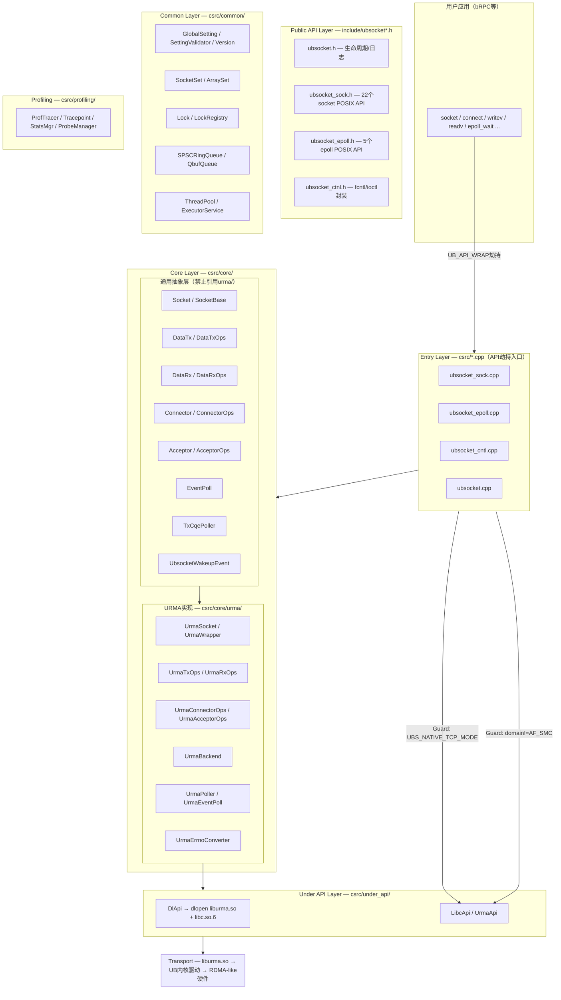

### 1.2 公共API覆盖

| 头文件 | 函数数 | 类别 |
|--------|--------|------|
| `ubsocket.h` | 8 | 库生命周期 + 日志 + IO缓冲区 |
| `ubsocket_sock.h` | 22 | socket / close / shutdown / readv / writev / send / recv 等 |
| `ubsocket_epoll.h` | 5 | epoll_create / epoll_create1 / epoll_ctl / epoll_wait / epoll_pwait |
| `ubsocket_ctnl.h` | 3 | fcntl / fcntl64 / ioctl |

**总计38个公共C API函数**，全部声明为 `extern "C"`。

### 1.3 目录结构速查

```
src/ubsocket/
├── include/                     # 公共C API头文件（5个）
├── UBSOCKET_VERSION             # 全仓统一版本号（当前：1.0.0）
├── csrc/
│   ├── ubsocket.cpp             # 库初始化/uninit/日志/版本
│   ├── ubsocket_sock.cpp        # socket/close/shutdown/readv/writev等劫持
│   ├── ubsocket_epoll.cpp       # epoll_create/ctl/wait劫持
│   ├── ubsocket_cntl.cpp        # fcntl/ioctl劫持
│   ├── common/                  # 基础设施（28个文件）
│   ├── core/                    # 核心层
│   │   ├── ubsocket_*.h/cpp     # 通用抽象层（14个文件）
│   │   └── urma/                # URMA实现（44个文件）
│   ├── under_api/               # 动态库加载封装（7个文件）
│   ├── iobuf/                   # 零拷贝Block/BlockCache（3个文件）
│   ├── profiling/               # 维测基础设施（19个文件）
│   └── cli/                     # CLI诊断工具（7个文件）
├── unit_test/                   # 测试（gtest + mockcpp）
└── tools/                       # 辅助工具
```

---

## 2. 对象模型

### 2.1 Socket继承层次

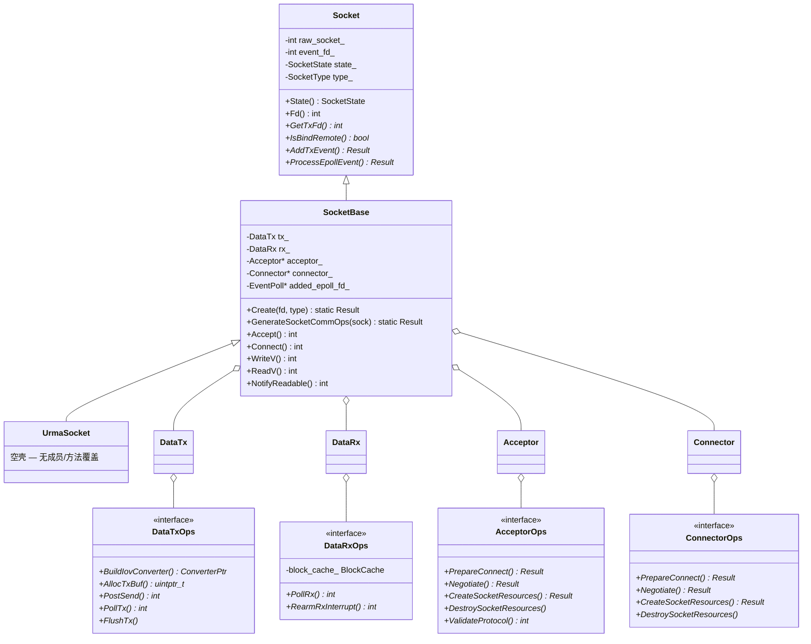

### 2.2 Socket 状态机

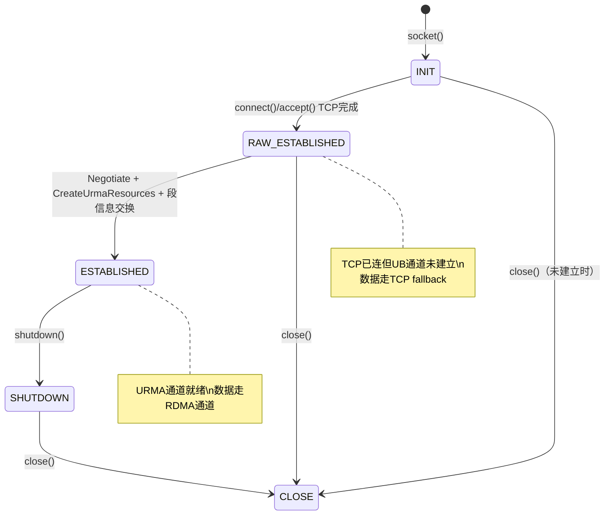

---

## 3. 版本协商协议

### 3.1 版本号编码

协议版本号采用32位编码：`[Major(6bit)][Minor(12bit)][Patch(14bit)]`。版本号来源：CMake/Bazel从 `UBSOCKET_VERSION` 文件自动生成，全代码仓统一。

| 宏 | 作用 |
|----|------|
| `UBS_MAKE_PROTOCOL_VERSION(major, minor, patch)` | 编码 |
| `UBS_PROTOCOL_VERSION_MAJOR(v)` | 提取Major (6bit, bit26-31) |
| `UBS_PROTOCOL_VERSION_MINOR(v)` | 提取Minor (12bit, bit14-25) |
| `UBS_PROTOCOL_VERSION_PATCH(v)` | 提取Patch (14bit, bit0-13) |
| `UBS_PROTOCOL_VERSION` | 当前版本 constexpr uint32_t |

### 3.2 协商流程

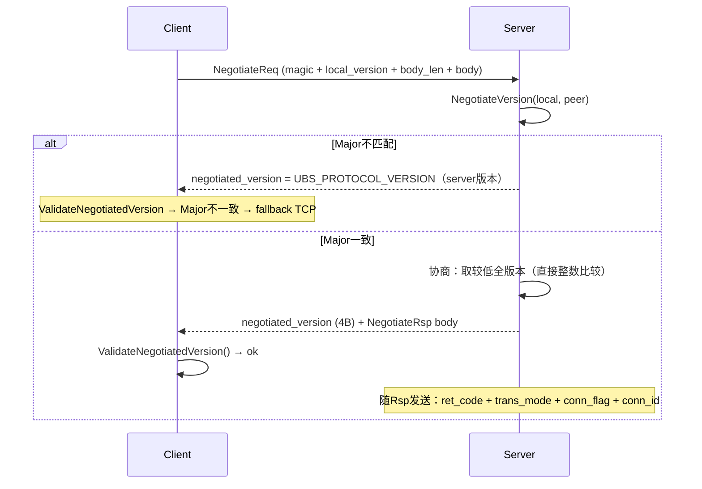

关键函数 (`ubsocket_version.h`):
- `NegotiateVersion(local, peer)` — Acceptor侧；Major一致→取较低全版本
- `ValidateNegotiatedVersion(local, negotiated)` — Connector侧校验
- Major不一致→降级TCP（不可重试）；Minor/Patch差异→按较低方交互

### 3.3 版本协商跨版本兼容

- `RecvLengthPrefixed` 读body_len后 `min(body_len, sizeof_struct)` 读body，不足零填、超出丢弃
- `NEGOTIATE_REQ_WIRE_SIZE` 自动跟随 `sizeof(NegotiateReq)`，struct变更后不需手动维护常量

---

## 4. 连接建立

### 4.1 握手模式

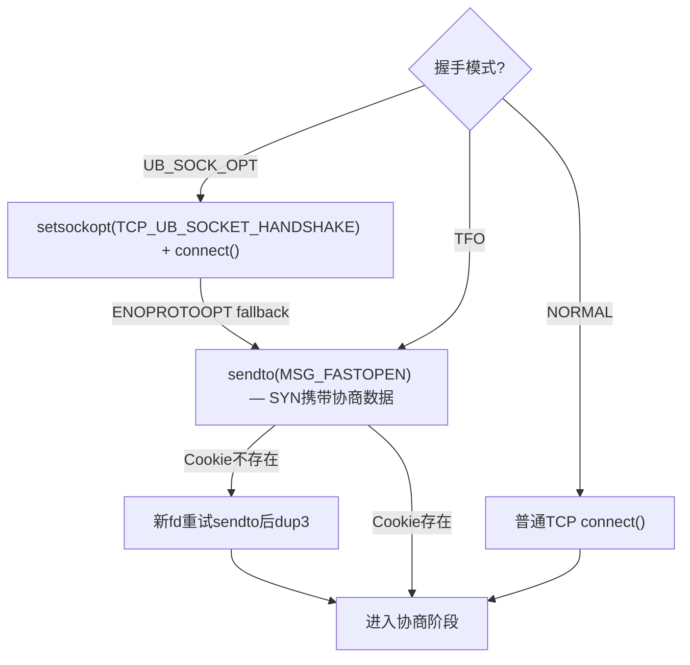

### 4.2 Connector 建链流程

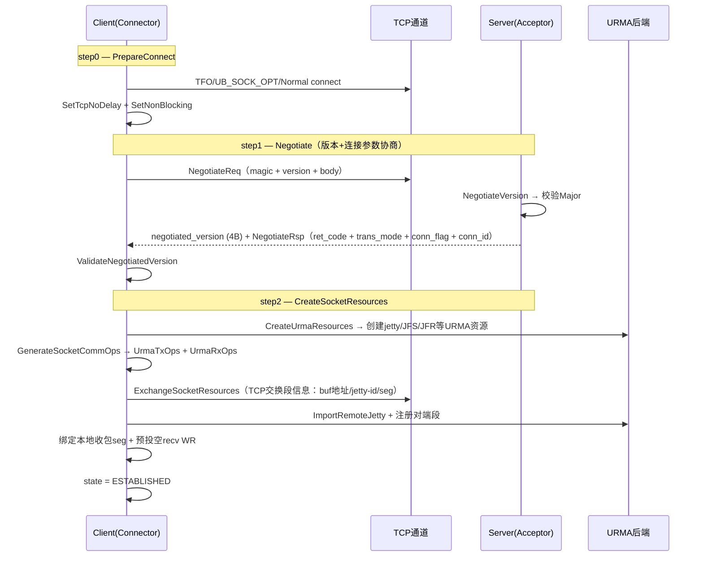

### 4.3 Acceptor 建链流程

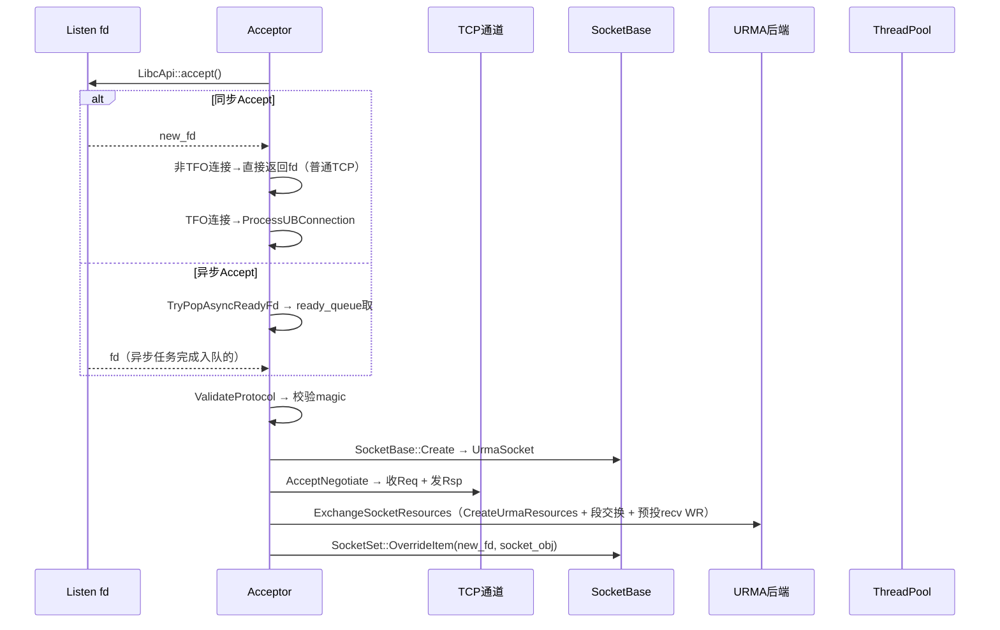

### 4.4 异步Accept流程

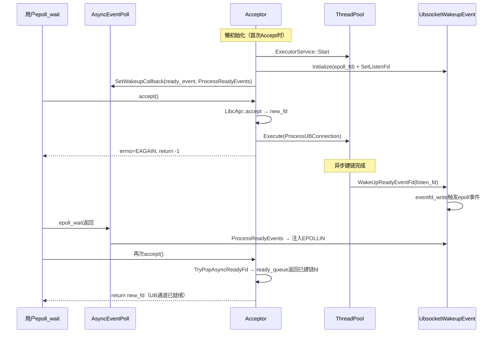

### 4.5 建链重试/降级状态机

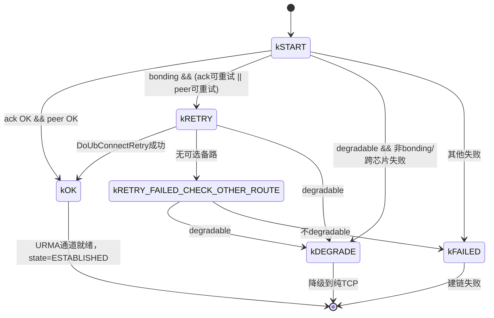

---

## 5. 数据面

### 5.1 发送流程（WriteV）

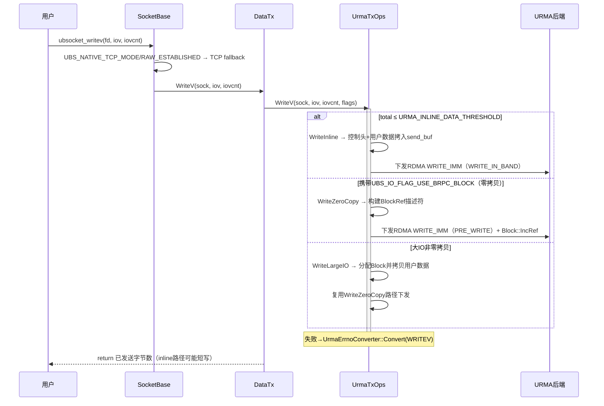

### 5.2 接收流程（ReadV + UrmaPoller）

#### CQE 派发（UrmaPoller后台线程）

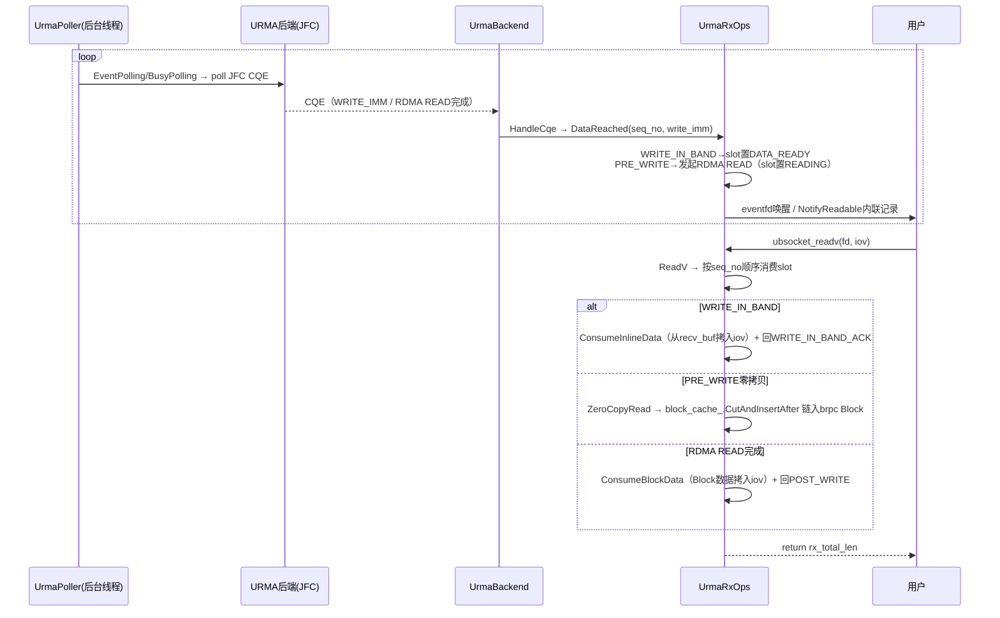

说明：
> - CQE 事件有两种派发策略：Inline 模式由 poller 线程立即处理；Dispatcher 模式事件入队（ReadableEventQueue），由 readv 排空时推进。
> - DISPATCHER 模式下，JFCE 中断 fd 注册进用户 epoll（UrmaEventPoll），JFC 轮询与派发在 epoll_wait 内联完成。

---

## 6. Epoll 多层架构

### 6.1 总体架构

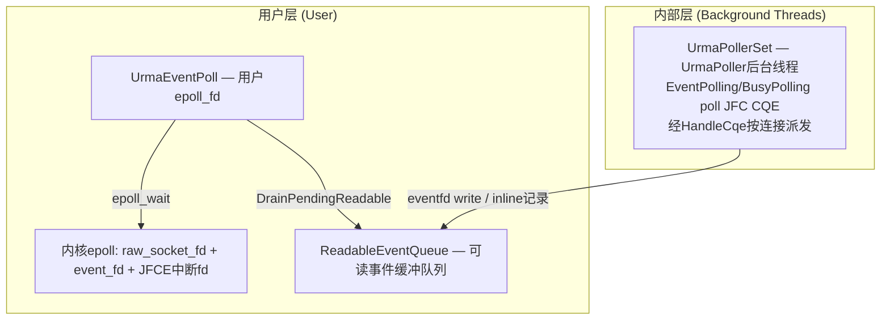

### 6.2 UrmaEventPoll 内部结构

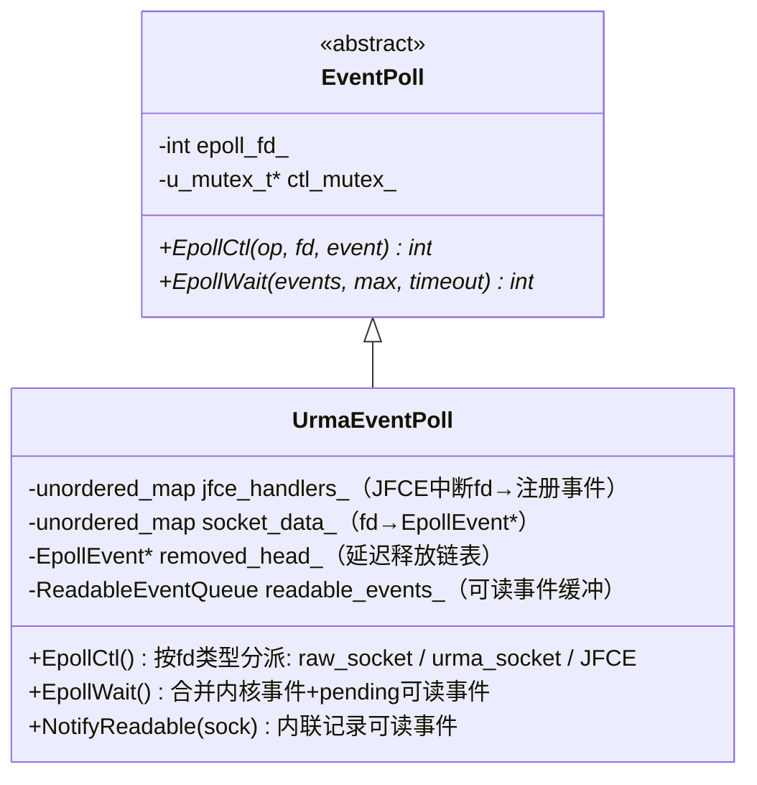

**EpollCtl分派逻辑**:
- `raw_socket_fd` → 透传到内核epoll
- urma socket fd → 内部托管（`AddUrmaSocketEvent`），不透传内核
- JFCE中断fd → 注册到`jfce_handlers_`，事件到来时内联poll CQE

---

## 7. 零拷贝IOBuf机制

### 7.1 Block结构（8K对齐）

```
 ┌──────────────────────8K对齐边界──────────────────────┐
 │  Block（2×8B + atomic 4B + …）│      buf_data       │
 └──────────────────────────────────────────────────────┘
                                  ▲
                                  │ PtrFloorToBoundary(buf_data)
                                  │ = (char*)buf_data - sizeof(Block)
```

`blockmem_allocate_zero_copy(size)` 分配8K对齐内存，在起始处placement new `Block`。通过8K对齐特性可回溯到`Block`。

### 7.2 Block / BlockCache

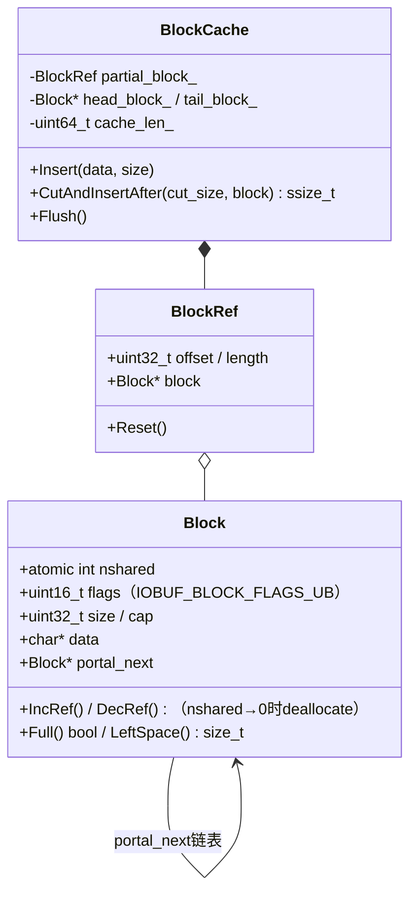

### 7.3 数据交付给brpc

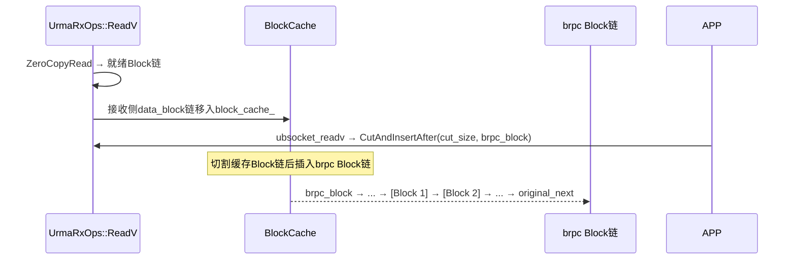

---

## 8. 库初始化

### 8.1 初始化流程

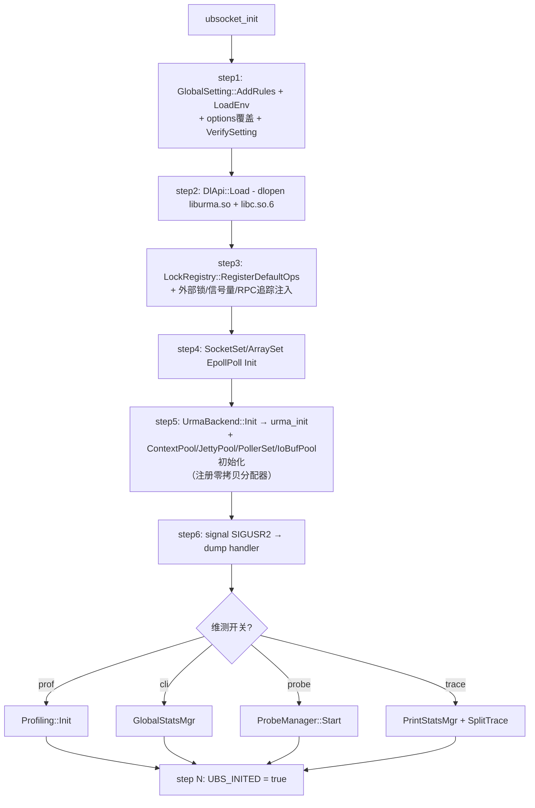

### 8.2 初始化选项（`u_init_options_t`）

| 字段 | 默认值 | 说明 |
|------|--------|------|
| `allowed_protocol` | `UBS_PROTOCOL_TCP` | 允许的传输协议 |
| `async_acceptor_thread_count` | 0 | 异步Accept线程数（0=同步） |
| `async_connector_enable` | `false` | Client 全异步建链开关（true=异步，false=同步） |
| `async_epoll_thread_count` | 1 | 后台epoll线程数 |
| `lock_ops` | nullptr | 外部互斥锁注入（brpc butex等） |
| `rw_lock_ops` | nullptr | 外部读写锁注入 |
| `sem_ops` | nullptr | 外部信号量注入 |
| `rpc_id_ops` | nullptr | 外部RPC上下文追踪 |

---

## 9. UrmaErrnoConverter

### 9.1 两种映射路径

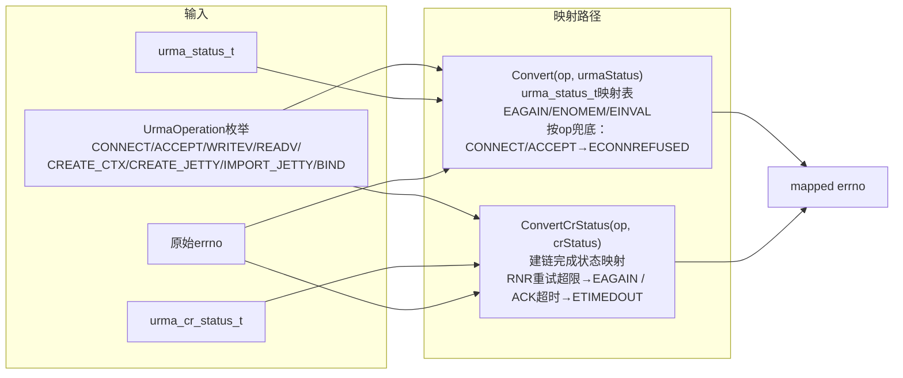

覆盖8种UrmaOperation，errno在生产代码调用URMA API后**立即保存**（errno必须在调用被测函数之前设置）。

---

## 10. 核心设计模式

| 模式 | 位置 | 作用 |
|------|------|------|
| **函数劫持** | `UB_API_WRAP()` 宏 | 透明替换POSIX调用 |
| **Strategy(Ops)** | 5组虚接口 | 可插拔传输实现 |
| **Factory** | `SocketBase::Create / GenerateSocketCommOps` | 按SocketType创建ops |
| **Template Method** | `Connector::Connect / Acceptor::Accept` | 固定步骤: Prepare→Negotiate→CreateResources |
| **Singleton** | `SocketSet / ArraySet` | 全局注册表 |
| **Leaky Singleton** | `TxCqePoller / UrmaPollerSet` | 进程生命周期，不析构 |
| **Bridge/Adapter** | `UrmaApi / LibcApi / DlApi` | 抽象dlopen vs 直接链接 |
| **Guard/Bypass** | `UBS_NATIVE_TCP_MODE` 检查 | UB不可用时回退TCP |
| **Ref Counting** | `DECLARE_REF_COUNT_VARIABLE` | Socket / EventPoll / Ops生命周期 |
| **State Machine** | `UBHandshakeState` | 建链重试/降级控制 |
| **Scope Exit** | `MakeScopeExit()` | RAII资源恢复 |

---

## 11. 关键概念速查

### Share-JFR（共享接收队列）
URMA支持`URMA_SHARE_JFR`共享接收模式：多个连接可共享JFR（共享接收队列），CQE由UrmaPoller后台统一poll并按连接派发；连接也可使用独占jetty。

### 双层Epoll
**用户层**（UrmaEventPoll）：合并内核事件 + 可读事件缓冲队列（ReadableEventQueue）。**内部层**（UrmaPollerSet）：后台线程poll JFC CQE并按连接派发；Dispatcher模式下JFCE事件在用户epoll_wait内联处理。

### TCP Fallback
`UBS_NATIVE_TCP_MODE`守卫 + `RAW_ESTABLISHED`状态时走TCP。建链失败时通过`IsDegradable()`判断是否可降级到纯TCP。

### 外部锁注入
`u_init_options_t`提供mutex/rwlock/semaphore/rpc_id四个函数指针表，brpc可注入自己的butex/semaphore实现。

### 依赖方向规则
- 通用层（`core/ubsocket_*`）禁止引用任何具体实现子目录头文件
- 工厂方法（`ubsocket_socket.cpp`）是唯一例外——它根据`SocketType`创建具体对象
- 具体实现层（`core/urma/*`）可引用通用层头文件
