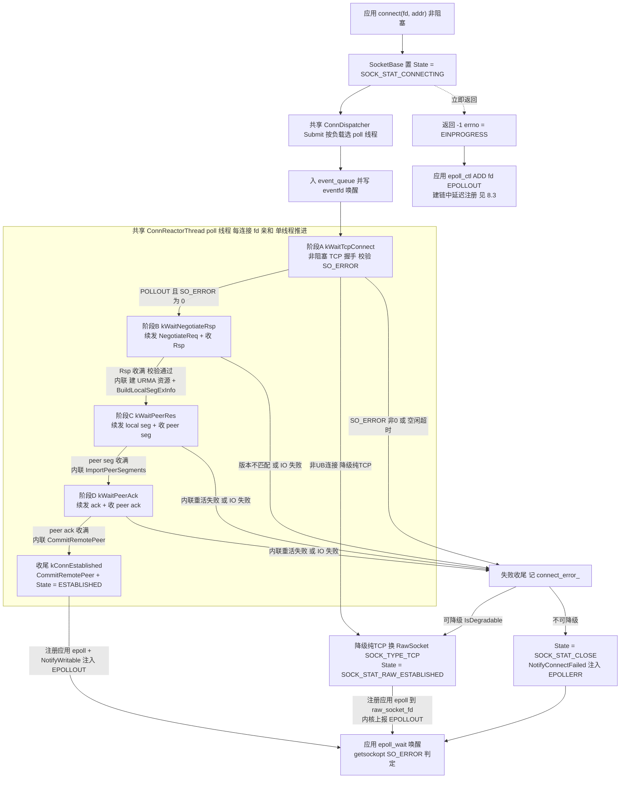
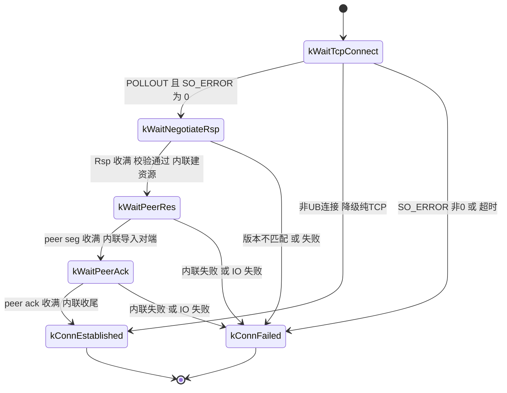

# UBSocket Client 侧全异步建链设计

> **定位**：描述 Client 侧非阻塞 `connect()` 的异步建链改造。
> **状态**：设计稿（统一共享池版，2026-09 修订）。**前置已完成**：Server 侧已完成"poll 线程内联重活"改造
> 并已按 §5.0 **泛化为共享** `ConnReactorThread` / `ConnDispatcher` / `ConnEventFdTable` + `UBConnOpsBase`；
> Client 直接复用同一 poll 池，无需再改 Server 的类结构。
>
> **目标**：把同步 `connect()` 中会阻塞调用线程的 TCP 握手 + 版本协商 + URMA 资源交换
> 从应用线程卸载到**进程级共享**异步建链 poll 线程池，**不改变** POSIX `connect()` 语义。
>
> **本版核心变更（相对初版）**：
> 1. **复用 Server 已落地的 poll 池**：先做 P0 泛化（§5.0），把 Server 侧 reactor/dispatcher 抽为共享
>    `ConnReactorThread` / `ConnDispatcher` / `ConnEventFdTable`，并抽公共状态机基类 `UBConnOpsBase`；
>    Server/Client 连接投递到同一进程级 poll 池，按统一负载均衡选线程。
> 2. **两侧统一"poll 线程内联重活"**：URMA 资源创建/对端导入/收尾等本地操作**直接在 poll 线程上
>    同步执行**，不切换线程。所谓"异步"只针对 **IO 层面**——只有涉及网络交互（send/recv）的阶段才
>    需要非阻塞，其余全部在当前 poll 线程内完成。与已实现的 Server 侧一致：**无 `ExecutorService`、
>    无完成队列、无重活在途态，空闲超时用有效时钟**。
> 3. 状态机基类为共享的 `UBConnOpsBase`（承载 fd / `AsyncConnBuffer` / `Abort` / `WantsWritable` /
>    `SendControlNonBlocking` / `FlushPendingSend` / `pending_send_buf_` / 有效时钟 / 超时与 close 策略）；
>    `ClientConnState` 仅保留 Client 专有状态。
> 4. **v1 含 `CONNECTING` 期 epoll_ctl 延迟注册**：建链中应用调用 `epoll_ctl(ADD)` 时，
>    `urma_socket` 尚未就绪、且可能降级为纯 TCP，此时**既不能把 raw_socket_fd 直接交给内核
>    （会提前上报可写），也不能直接把 event_fd 交给内核（降级后事件会丢）**；改为**先记录
>    应用的 events/data，待建链完成、最终类型确定后再按最终类型注册**。详见 §8.3。

---

## 1. 文档信息

| 项目 | 内容 |
|------|------|
| 需求 | UBSocket Client 侧建链全异步化改造（复用共享 poll 池） |
| 前置 | **已完成**：Server 侧已泛化为共享 `ConnReactorThread` / `ConnDispatcher` / `ConnEventFdTable` + `UBConnOpsBase`（§5.0） |
| 目标传输层 | URMA（`csrc/core/urma/`，当前活跃路径）；UMQ 后续按同模式扩展 |
| 控制开关 | `u_init_options_t::async_connector_enable`（bool，`ubsocket_def.h`，env `UBSOCKET_ASYNC_CONNECTOR_ENABLE` 覆盖） |
| 开关判定 | `GlobalSetting::AsyncConnectorEnabled()`（`ubsocket_global_setting.h`，读 `UBS_CONNECTOR_ASYNC_ENABLE` bool） |
| poll 线程数 | `GlobalSetting::UBS_CONN_POLL_THREAD_NUM`（env `UBSOCKET_CONN_POLL_THREAD_NUM`，默认 1），Server/Client 共用（见 Server 文档 §7.2） |
| poll 池 | **共享** `ConnDispatcher`（Server/Client 同一实例，P0 后） |
| 重活执行 | **无独立/共享重活池**：URMA 本地重活在 poll 线程内联执行 |
| 设计原则 | 不改变 `connect()` 的 POSIX 语义与建链协议，通过开关切换新老路径 |

---

## 2. 设计取舍与风险（必读）

本版与 Server 侧**统一**为"**poll 线程内联重活 + IO 非阻塞**"，共用同一个 poll 池，且全异步路径不使用
`ExecutorService`（`ExecutorService` 仅供半异步 accept）。两侧状态机因此同构：只有 recv 等待态 + 内联重活，
无重活在途态、无完成队列。

| 维度 | 统一内联（本设计，Server/Client 一致） | 旧 Server 方案（已废弃） |
|------|---------------------------------------|--------------------------|
| 状态机 | 简单：只有 recv 等待态 | 复杂：额外重活在途态 + 完成队列 + 唤醒链路 |
| 线程切换 | 无 | 每阶段 2 次跨线程唤醒 |
| 完成通知 | 无需 `completion_queue_` | 需 `completion_queue_` + eventfd 自旋保不丢 |
| epoll 竞态面 | 小：建链收尾只在 poll 线程 | 大：executor 线程与 poll 线程并发改 socket |
| 单 poll 线程吞吐 | 重活串行化，会拖住同线程其它连接 | 重活并行，poll 线程不被拖住 |

**风险**：Server 侧曾实测"重活内联进 poll 线程"，在 1000/10000 并发下 poll 线程被 ms 级
`CreateUrmaResources` 串行化拖住，尾连接因对端超时先 close。该约束已部分消除——对端等 rsp 的预算从
10ms 放宽到 `NEGOTIATE_REPLY_TIMEOUT_MS = 2000`（`ubsocket_defines.h:199`）；剩余约束是段交换预算
`CONTROL_PLANE_TIMEOUT_MS = 2000`。**已实现的 Server 侧以"内联 + 有效时钟 + 线程数旋钮"落地**：
poll 线程内联重活期间用有效时钟（`busy_ms_`）扣除本线程处理耗时，避免把"线程忙于其它连接"误算成
"本连接对端静默"而误杀（见 Server 文档 §7.7）。Client 侧沿用同一机制。

**缓解措施**：
- poll 线程数按两侧合并后的峰值配置（Server 文档 §7.2），多线程分摊重活；必须满足
  `(单线程在途连接数) 乘 (单次重活耗时) < 2000ms`。
- 对单次重活耗时打点（复用 `PROF_RECORD`），若实测拖尾严重，再按连接/阶段做"每连接独立
  线程"或"按需卸载"，不改动协议与状态机骨架。
- 内联重活**绝不包含阻塞 send/recv**：只调用 `CreateUrmaResources` / `BuildLocalSegExInfo` /
  `ImportPeerSegments` / `CommitRemotePeer` 等本地方法，控制面帧一律暂存 `pending_send_buf_`
  交由非阻塞续发。
- Client 是主动发起方，单进程并发建链数通常远低于 Server accept，对共享池的压力相对可控。

---

## 3. Client 与 Server 的映射

| # | Server 侧做法 | Client 侧对应 |
|---|--------------|--------------|
| 1 | 每线程一个 while 循环，循环内 `LibcApi::poll()` 监听本线程所有 socket fd；单线程串行推进多个连接 | **直接复用**共享 `ConnReactorThread`：循环、fd 槽位、`POLLIN`/`POLLOUT` 追加逻辑照搬，**不新建 Client 池** |
| 2 | 建链以 **recv 对端消息** 为界拆成多个本地阶段；读满后内联重活 | **同构但方向相反**：Client 是发起方，协议先 send 后 recv。每阶段形如"续发上一阶段暂存帧 -> recv 对端消息"。读满后**在 poll 线程内联执行本地重活**，不切换线程 |
| 3 | 对端每发一条消息即 fd 可读，唤醒该 socket 所属线程的 poll，按状态执行对应阶段 | **复用**：`poll` 返回 `POLLIN`/`POLLOUT` -> `HandleSocketFd(fd)` -> `ops->Execute(effective_now_ms)` 按 `state_` 分发；**无完成队列**，阶段推进在同一次 `Execute()` 内完成 |
| 4 | `done_cb` 在成功收尾 push `ready_queue` + 唤醒 acceptor | Client 的完成通知由 `UBClientConnOps::OnConnDone` 内的延迟 epoll 注册 + `EPOLLOUT` 注入完成（done_cb 可为空） |

一句话：**Client = Server 的阶段划分 + 内联重活 + 共享 poll 池**——复用 poll 线程池 / 非阻塞增量收发 /
eventfd 唤醒，去掉重活卸载层，且不再自建池。

---

## 4. 现状：同步 Client 建链

```
ubsocket_connect(fd)                                  ubsocket_sock.cpp:148
 └─ SocketBase::Connect                               ubsocket_socket.h:179
     └─ Connector::Connect                            ubsocket_socket_connector.cpp:152
         ├─ PrepareConnect  -> DoTcpConnect (TFO / UB_SOCK_OPT)          阻塞
         ├─ Negotiate       -> SendLengthPrefixed / RecvLengthPrefixed   阻塞（poll 限时）
         ├─ CreateSocketResources -> GenerateSocketCommOps + ExchangeSocketResources   最重
         └─ IsDegradable(ret) -> 换 RawSocket(SOCK_TYPE_TCP)   ubsocket_socket_connector.cpp:183
```

URMA Client 控制面 wire 序列（`urma_socket_connector_ops.cpp` + `urma_socket.cpp:339`）：

| 序号 | 方向 | 内容 | 异步化后执行线程 |
|------|------|------|----------------|
| C1 | send | `UrmaNegotiateReq` | poll（非阻塞） |
| R1 | recv | `UrmaNegotiateRsp` | poll（非阻塞） |
| C2 | 本地 | `GenerateSocketCommOps` + `CreateUrmaResources` + `BuildLocalSegExInfo` | **poll 内联** |
| C3 | send | `local seg`（`UrmaSockSegExInfo`） | poll（非阻塞） |
| R2 | recv | `peer seg`（`UrmaSockSegExInfo`） | poll（非阻塞） |
| C4 | 本地 | `ImportPeerSegments`（`ImportRemoteJetty` + `store_remote_target_seg` + post empty recv） | **poll 内联** |
| C5 | send | `ack_ret`（`Result`） | poll（非阻塞） |
| R3 | recv | `peer_ret`（`Result`） | poll（非阻塞） |
| C6 | 本地 | `CommitRemotePeer` + `SetBindRemote(true)` | **poll 内联** |

> `BuildLocalSegExInfo` / `ImportPeerSegments` / `CommitRemotePeer` 已由 Server 异步新增为
> `UrmaSocket` 公有方法（`urma_socket.cpp:469/498/533`），Client 直接复用。
>
> 同步路径超时常量：`CONTROL_PLANE_TIMEOUT_MS = 2000`（`ubsocket_defines.h:192`）。

---

## 5. 总体设计

### 5.0 P0 泛化（Server 侧改造，已完成）

Server 侧已实现"poll 线程内联重活 + 有效时钟"。为让 Client 复用同一 poll 池，已做一次**纯重构**（不改行为）：
把 Server 专属的 reactor/dispatcher/ops 抽为共享设施 + 公共状态机基类 `UBConnOpsBase`，Server 行为不变。
下表为泛化前后对照（已落地）：

| 泛化前（Server 专属） | 泛化后（共享） | 说明 |
|--------------------|------------------|------|
| `ServerConnReactorThread`（`ubsocket_server_conn_reactor.h`） | `ConnReactorThread`（`ubsocket_conn_reactor.h`） | poll 循环 / fd 槽位 / `event_queue_` / `busy_ms_` 有效时钟；`AddConnection` 参数类型为 `shared_ptr<UBConnOpsBase>` |
| `ServerConnDispatcher` | `ConnDispatcher` | 共享 poll 池；`Start` / `Stop` 不涉及 `ExecutorService` |
| `ServerConnEventFdTable` | `ConnEventFdTable` | 负载均衡表，逻辑不变 |
| `UBServerConnOps`（`ubsocket_server_conn_ops.h`） | 抽 `UBConnOpsBase` + 保留 `UBServerConnOps` | 基类承载 fd / `AsyncConnBuffer` / `Abort` / `WantsWritable` / `SendControlNonBlocking` / `FlushPendingSend` / `pending_send_buf_` / `last_active_ms_` / 有效时钟；虚接口 `StateName()` / `IdleTimeoutMs()` / `CloseOnFailure()` / `OnConnDone()` / `OnConnFailed()` |
| `ConnStageResult`（`ubsocket_server_conn_types.h`） | `ConnStageResult`（`ubsocket_conn_types.h`） | 已移入共享头；`ServerConnState` / `ServerConnStateName` 留 Server 侧 |
| `AsyncConnBuffer`（`ubsocket_server_conn_buffer.h`） | `AsyncConnBuffer`（`ubsocket_conn_buffer.h`） | 通用非阻塞增量读缓冲 |
| `ServerConnReactorThread::DoneCallback` | `ConnReactorThread::DoneCallback` | 不变 |

泛化要点（已落地）：
- **`Submit` 直接接收 ops**：`ConnDispatcher::Submit(fd, addr, addr_len, done_cb, ops)`，由调用方经工厂
  （Server 用 `SocketBase::CreateServerConnOps`；Client 后续加 `CreateClientConnOps`）创建 `UBConnOpsBase` 再传入。
  工厂返回类型已由 `shared_ptr<UBServerConnOps>` 改为 `shared_ptr<UBConnOpsBase>`。
- **close 策略下放**：`FinishConnection` 不再无条件 `close(fd)`，改由 `ops->CloseOnFailure()` 决定
  （Server=true，Client=false，见 §7.8）。
- **超时策略下放**：`ScanTimeoutConnections` 用 `ops->IdleTimeoutMs()` 而非硬编码 `SERVER_CONN_IDLE_TIMEOUT_MS`。
- **成功收尾下放**：`kDone` 分支先调 `ops->OnConnDone()`，再调 `done_cb`。
- **新增 `Cancel(fd)`**：`ConnDispatcher::Cancel` / `ConnReactorThread::Cancel` 已新增（`Abort()` + `cancel_queue_`
  跨线程投递，poll 线程移出监听与映射）；Server 侧不用，供 Client 建链中 `close` 使用（见 §7.10）。
- 纯重命名/抽基类，**行为与泛化前 Server 侧完全一致**。

### 5.1 复用的共享设施（来自 Server 文档 §6）

| 设施 | 位置 | 复用方式 |
|------|------|----------|
| `ConnReactorThread` | `csrc/core/ubsocket_conn_reactor.h`（P0 泛化） | **共享实例**：poll 循环、fd 槽位、`event_queue_`、`busy_ms_` 有效时钟；**无 completion 队列** |
| `ConnDispatcher` / `ConnEventFdTable` | 同上（P0 泛化） | **共享实例**：按统一负载选线程、`Submit` / `Cancel` |
| `UBConnOpsBase` | `csrc/core/ubsocket_conn_ops_base.h`（P0 抽取） | Client 状态机基类：fd / `AsyncConnBuffer` / `Abort` / `WantsWritable` / `SendControlNonBlocking` / `FlushPendingSend` / `pending_send_buf_` / `IdleTimeoutMs` / `CloseOnFailure` |
| `ConnStageResult` | `csrc/core/ubsocket_conn_types.h`（P0 迁移） | 保留 `kPending` / `kDone` / `kFailed` |
| `AsyncConnBuffer` | `ubsocket_server_conn_buffer.h`（P0 后可改名） | 非阻塞增量收帧，直接复用 |
| `NotifyWritable` 链路 | `ubsocket_socket.h:232` -> `DoNotifyWritable` `:252` | 建链成功向应用注入 `EPOLLOUT` |
| ~~`ExecutorService`~~ | ~~`ubsocket_thread_pool.h`~~ | **全异步建链不使用**；仅半异步 accept 使用 |

> 依赖方向：通用层（`core/ubsocket_conn_*.{h,cpp}`）不得 `#include "urma/..."` / `"umq/..."`；
> 具体实现经工厂 `SocketBase::CreateClientConnOps` 创建，与 `CreateServerConnOps`
> （`ubsocket_socket.cpp:255`）同款。

### 5.2 组件总览

| 组件 | 层级 | 职责 |
|------|------|------|
| `ClientConnState` | 通用 | Client 建链状态枚举（仅 recv 等待态 + 终态） |
| `UBClientConnOps` | 通用 | Client 状态机基类（`Execute` 分发，无重活提交，继承 `UBConnOpsBase`） |
| `ConnReactorThread` | 通用（共享） | poll 线程：event fd + 任务队列 + 监听数组；**无 completion 队列** |
| `ConnDispatcher` | 通用（共享） | 共享 poll 池：启动、按负载选线程、`Submit` / `Cancel` |
| `UrmaClientConnOps` | urma | URMA Client 状态机实现（poll 非阻塞 IO + 内联本地重活） |
| `UmqClientConnOps` | umq（后续） | UMQ Client 状态机实现 |

### 5.3 执行模型：poll 线程内联重活 + 非阻塞 IO

一次 `Execute()` 的通用形态（与 Server 完全同构）：

```
Execute()  [运行于共享 poll 线程]
  ├─ 若 pending_send_buf_ 非空：FlushPendingSend()        // 非阻塞续发
  │    └─ EAGAIN -> 置 wants_writable_，返回 kPending（reactor 追加 POLLOUT）
  ├─ 非阻塞增量 recv 对端本阶段消息
  │    └─ 半包(EAGAIN) -> 返回 kPending（fd 保留在监听数组）
  ├─ 收满 -> 在当前线程内联执行本地重活（建资源 / 导入对端 / 收尾）
  │    ├─ 失败 -> 返回 kFailed
  │    └─ 成功 -> 把下一阶段待发帧暂存 pending_send_buf_，切 state_
  └─ 返回 kPending（下一阶段由后续 POLLIN/POLLOUT 驱动）
```

关键点：
- **重活只在 recv 收满后执行**，且**只调用本地方法**，不发起任何阻塞 IO。
- 重活结果若需发送，**不在重活内发送**，而是暂存 `pending_send_buf_`，由后续 `Execute()`
  非阻塞续发（与 Server `DoWaitPeerRes` 先 `FlushPendingSend` 再 recv 同款）。
- **暂存后必须置 `wants_writable_ = true`**：阶段切换时下一帧只是暂存、尚未发送，reactor 需据此为该 fd
  追加 `POLLOUT` 才能续发；否则只监听 `POLLIN`，双方互等对方的 seg/ack 会造成建链死锁。`FlushPendingSend`
  发完清位（Server 侧 `CreateResourcesAndStageLocal` / `ImportPeerAndStageAck` 同款处理）。
- 由于重活在 poll 线程内联，**不存在"重活在途"状态**，`Execute()` 返回时 `state_` 必定是
  某个"等待 recv"态或终态。

### 5.4 总体架构



**读图要点**：建链过程中**不向应用 epoll 注册任何事件**（延迟注册）；三条收尾路径
（正常成功 `PF`、降级成功 `DEG`、失败 `ERR`）都发生在 poll 线程，最终类型确定后才注册
应用 epoll 并投递事件，统一由应用 `getsockopt(SO_ERROR)` 判定。

---

## 6. 状态机设计

### 6.1 状态枚举（`ubsocket_client_conn_types.h`）

```cpp
enum class ClientConnState : uint8_t {
    kWaitTcpConnect = 0,   /* poll: 非阻塞 TCP 握手 + 校验 SO_ERROR；非UB则降级 */
    kWaitNegotiateRsp,     /* poll: 续发 NegotiateReq -> 增量收 Rsp -> 收满后内联建 URMA 资源 */
    kWaitPeerRes,          /* poll: 续发 local seg -> 增量收 peer seg -> 收满后内联 ImportPeerSegments */
    kWaitPeerAck,          /* poll: 续发 ack -> 增量收 peer ack -> 收满后内联 CommitRemotePeer */
    kConnEstablished,      /* 终态 */
    kConnFailed,           /* 终态 */
};

constexpr uint64_t CLIENT_CONN_IDLE_TIMEOUT_MS = 10000; /* 对齐 SERVER_CONN_IDLE_TIMEOUT_MS */
```

对照 Server 的 5 态（`ubsocket_server_conn_types.h`）：Client 去掉 `kWaitNegotiateReq`
（发起方不发 req 等待），新增 `kWaitTcpConnect`（主动连接独有），其余三阶段 + 两终态对应。

### 6.2 阶段拆分与转移表

| 状态 | 执行线程 | 入口先做 | 边界（recv） | 收满后内联重活 | 成功后 | 失败后 |
|------|----------|----------|--------------|----------------|--------|--------|
| `kWaitTcpConnect` | poll | 首次 `PrepareConnect`；`POLLOUT` 后 `getsockopt(SO_ERROR)` | TCP 握手（非对端消息） | 无 | `kWaitNegotiateRsp`（并暂存 req） / 降级 `kConnEstablished` | `kConnFailed` |
| `kWaitNegotiateRsp` | poll | 续发 `NegotiateReq` | `UrmaNegotiateRsp` | `GenerateSocketCommOps` + `CreateUrmaResources` + `BuildLocalSegExInfo` | `kWaitPeerRes` | `kConnFailed` |
| `kWaitPeerRes` | poll | 续发 local seg | `peer seg` | `ImportPeerSegments` + 暂存 ack | `kWaitPeerAck` | `kConnFailed` |
| `kWaitPeerAck` | poll | 续发 ack | `peer ack` | `CommitRemotePeer` + `SetBindRemote(true)` | `kConnEstablished` | `kConnFailed` |
| `kConnEstablished` | poll 收尾 | 注册应用 epoll + `NotifyWritable` | — | — | 终态 | — |
| `kConnFailed` | poll 收尾 | 记 `connect_error_` / 降级 | — | — | — | 终态 |

> 注意：**没有"重活在途"状态**。上表"收满后内联重活"发生在同一次 `Execute()` 调用内，
> 完成后立即切到下一 recv 等待态并返回 `kPending`。

### 6.3 状态机图



### 6.4 `UBClientConnOps`

继承共享基类 `UBConnOpsBase`（承载 fd / `AsyncConnBuffer` / `Abort` / `WantsWritable` /
`SendControlNonBlocking` / `FlushPendingSend`），只保留 Client 专有逻辑：

```cpp
class UBClientConnOps : public UBConnOpsBase {
public:
    ConnStageResult Execute(uint64_t effective_now_ms) override;   /* poll 线程唯一入口：按 state_ 分发 */
    uint64_t IdleTimeoutMs() const override { return CLIENT_CONN_IDLE_TIMEOUT_MS; }
    bool CloseOnFailure() const override { return false; }  /* fd 归应用，失败不 close */

    virtual void OnConnDone();                       /* 成功收尾：State(ESTABLISHED) + 延迟注册 epoll + NotifyWritable */
    virtual void OnConnFailed();                     /* 失败收尾：connect_error_ + 降级或 NotifyConnectFailed */

protected:
    virtual ConnStageResult DoWaitTcpConnect() = 0;
    virtual ConnStageResult DoWaitNegotiateRsp() = 0;
    virtual ConnStageResult DoWaitPeerRes() = 0;
    virtual ConnStageResult DoWaitPeerAck() = 0;

    std::atomic<ClientConnState> state_{ClientConnState::kWaitTcpConnect};
    SocketPtr sock_;                  /* Ref 保活：应用提前 close 也不释放对象 */
    ConnectorOpsPtr connector_ops_;   /* per-socket 有状态 ops（route/retry 状态必须复用同一实例） */
};
```

> **无** `SubmitHeavyWork` / `HeavyDoneCallback` / `heavy_submit_ns_` / `RunHeavyWork` /
> `completion_queue_`。fd / `buf_` / `pending_send_buf_` / `last_active_ms_` / `aborted_` /
> `wants_writable_` 由 `UBConnOpsBase` 提供。

---

## 7. 全异步建链执行流程

### 7.1 初始化（进程启动）

共享池由 `ubsocket_init`（`ubsocket.cpp`）统一启动，**Client 不再自建池**：

```cpp
if (GlobalSetting::ServerAsyncEnabled() || GlobalSetting::AsyncConnectorEnabled()) {
    uint32_t poll_threads = GlobalSetting::UBS_CONN_POLL_THREAD_NUM;
    if (poll_threads == 0) { poll_threads = GlobalSetting::UBS_THREAD_POOL_SIZE; }
    result = ConnDispatcher::Instance().Start(poll_threads);
    /* 失败可回退同步 connect */
}
```

> **现状与落地差异**：已实现的 Server 侧 `ubsocket_init` 目前只在 `ServerAsyncEnabled()` 时启动，
> 线程数已改用 `UBS_CONN_POLL_THREAD_NUM`（0 回退 `UBS_THREAD_POOL_SIZE`）。Client 落地时
> 需把启动条件补上 `|| AsyncConnectorEnabled()`（与 Server 同一处，见 Server 文档 §7.1）。
>
> **无共享 executor 生命周期问题**：本设计不启动任何重活池；`ExecutorService` 仅半异步 accept 使用，
> 其启停逻辑**保持现状、本版不动**（已实现：`Acceptor::InitWakeupEvent` 仅在 `AsyncAcceptorEnabled()`
> 时启动它）。Client 侧只依赖共享 poll 池，其启停归 `ubsocket_init` / `ubsocket_uninit`。线程数用单一旋钮
> `UBS_CONN_POLL_THREAD_NUM`（原 `UBS_SERVER_HANDLER_NUM` 重命名，旧 env 兼容），不再 `max` 合并。

### 7.2 入口分流（`ubsocket_sock.cpp:148`）

```cpp
SocketPtr sock = ArraySet<Socket>::GetInstance().GetItem(fd);
if (sock == nullptr) { errno = EBADF; return -1; }
sock->create_type_ = SOCK_CREATE_TYPE_CONNECT;
auto sockBase = RefStaticCastToRaw<SocketBase>(sock);

bool nonblocking = !SocketConnHelper::IsBlocking(fd);
/* TFO 模式不走异步：DoConnectViaTfo 会临时切阻塞，不能污染共享 poll 线程（见 §7.3） */
bool tfo = (GlobalSetting::UBS_HAND_SHAKE_MODE == UBHandshakeMode::TFO);
if (GlobalSetting::AsyncConnectorEnabled() && nonblocking && !tfo &&
    sock->Type() != SocketType::SOCK_TYPE_TCP) {
    return sockBase->ConnectAsync(sock, address, address_len);   /* 新增 */
}
return sockBase->Connect(sock, address, address_len);            /* 原同步 */
```

`SocketBase::ConnectAsync`：

1. `sock->State(SOCK_STAT_CONNECTING)`；`SetWritableReady(false)`；`SetEvents(0)`；
   `connect_error_ = 0`；`connect_inflight_ = true`（见 §8.4）。
2. 工厂 `SocketBase::CreateClientConnOps(fd, sock, connector_ops, ops)` 创建状态机，注入
   `sock_`、`connector_ops_`、`sockaddr`。
3. `ConnDispatcher::Instance().Submit(fd, addr, addr_len, done_cb, ops)`：按负载选线程、
   置非阻塞、入 `event_queue_` + `eventfd_write` 唤醒。`done_cb` 可为空。
4. **立即返回 `-1` 且 `errno = EINPROGRESS`**；提交失败则回退同步 `Connect`。

### 7.3 阶段 A：`kWaitTcpConnect`（poll）

1. 首次进入调 `connector_ops_->PrepareConnect(fd, addr, addr_len, sock)`。
   - `DoTcpConnect`（`ubsocket_socket_connector.cpp:25`）在非阻塞 fd 上 `connect` 返回
     `EINPROGRESS` 已被归一为 `UBS_OK`（`:63`）。
   - TFO 模式 `DoConnectViaTfo` 会临时切阻塞再 `sendto(MSG_FASTOPEN)`（`:111-124`）。**v1 让 TFO 模式
     整体不走异步 connect**（§7.2 分流已排除 `UBS_HAND_SHAKE_MODE == TFO`），从而该阻塞只发生在应用
     线程，不污染共享 poll 线程。默认 `UB_SOCK_OPT` 走异步；若内核不支持该 sockopt，`DoConnectViaHandshakeOpt`
     会一次性把全局模式切成 TFO（`ubsocket_socket_connector.cpp:94`），该**首次 fallback 连接**会在 poll
     线程上短暂阻塞一次，此后所有连接自动走同步（可接受）。v2 再做纯非阻塞 TFO。
2. 若 `connect` 仍 `EINPROGRESS`：置 `wants_writable_ = true`（reactor 据此为该 fd 监听 `POLLOUT`），
   返回 `kPending`。
3. `POLLOUT` 重入：`getsockopt(fd, SOL_SOCKET, SO_ERROR, &err)`。
   - `err != 0` -> 记 `connect_error_`，返回 `kFailed`。
   - `err == 0` -> TCP 就绪；`SetTcpNoDelay`；重查 `IsUbsConnection(fd)`（TFO 模式此时才有效）。
4. `!IsUbsConnection(fd)` -> 纯 TCP：换 `RawSocket(SOCK_TYPE_TCP)`、`OverrideItem`、
   `State(RAW_ESTABLISHED)`，返回 `kDone`（对齐 `ubsocket_socket_connector.cpp:46` 早返回语义）。
5. 否则构造 `UrmaNegotiateReq` 暂存 `pending_send_buf_` 并置 `wants_writable_ = true`，进入
   `kWaitNegotiateRsp`。

> 阶段 A 只做非阻塞 TCP 握手，绝不 `send/recv` 业务数据。建链期 `wants_writable_` 兼作"需要 reactor
> 监听 `POLLOUT`"的开关（等 TCP 可写 / 有暂存待发帧）；`FlushPendingSend` 发完清位。

### 7.4 阶段 B：`kWaitNegotiateRsp`（poll + 内联建资源）

- 先 `FlushPendingSend()` 续发 `NegotiateReq`（`EAGAIN` 置 `wants_writable_` 返回 `kPending`）；
- 再用 `AsyncConnBuffer` 增量收 `UrmaNegotiateRsp`，半包 `kPending`；收满后
  `ValidateNegotiated` 校验版本（`urma_socket_connector_ops.cpp:108`），失败 `kFailed`。
- 校验通过 -> **内联重活**（对齐 `UrmaConnectorOps::CreateSocketResources`）：
  `GenerateSocketCommOps(sock)` + `CreateUrmaResources()` + `BuildLocalSegExInfo(local_seg_ex_)`；
  **不在重活内发送**，把 local seg 暂存 `pending_send_buf_`，`state_ = kWaitPeerRes`，返回 `kPending`。

### 7.5 阶段 C：`kWaitPeerRes`（poll + 内联导入对端）

- 先 `FlushPendingSend()` 续发 local seg；
- 再增量收 `peer seg`（`UrmaSockSegExInfo`），半包 `kPending`；收满后**内联重活**：
  `ImportPeerSegments(peer_seg_ex_)` + 暂存 `ack_ret`（`Result`）交续发，`state_ = kWaitPeerAck`。
- Client 的 socket 在 `connect` 前已注册进 `ArraySet`，**无需** Server 的 `RegisterSocket()` 内联注册。

### 7.6 阶段 D：`kWaitPeerAck`（poll + 内联收尾）

- 先 `FlushPendingSend()` 续发 ack；
- 再增量收 `peer_ret`（`Result`）；收满后**内联收尾**：`CommitRemotePeer(peer_seg_ex_)` +
  `SetBindRemote(true)`，`state_ = kConnEstablished`，返回 `kDone`。

### 7.7 成功收尾（`OnConnDone`）

1. `connector_ops_->conn_info.type_fd = 1`；`sock->create_type_ = SOCK_CREATE_TYPE_CONNECT`；
   `State(SOCK_STAT_ESTABLISHED)`；trace stats `CONN_COUNT`/`ACTIVE_OPEN_COUNT`
   （对齐 `ubsocket_socket_connector.cpp:196-202`）。
2. `connect_error_ = 0`；`connect_inflight_ = false`。
3. **通知应用**：先 `SetWritableReady(true)`（连接已就绪可写），再 `RegisterPendingEpollAdd()`
   按最终类型注册（见 §8.3）；注册路径据 `writable_ready_` 投递 `EPOLLOUT`，**无需再调
   `NotifyWritable()` 以免重复投递**。若应用尚未 ADD（无 pending），则维持 `writable_ready_=true`，
   应用后续 `epoll_ctl(ADD)` 时由 `EpollCtlAdd` 的 `ExchangeWritableReady(false)` 补投。

### 7.8 失败收尾（`OnConnFailed`）

1. 若 `IsDegradable(ret)` 且可降级：复用 `Connector::Connect` 降级逻辑
   （`ubsocket_socket_connector.cpp:183-194`）——新建 `RawSocket(SOCK_TYPE_TCP)`、`OverrideItem`、
   `State(RAW_ESTABLISHED)`，视为**成功**，走 §7.7 注册 + 通知（内核会因 raw fd 可写上报 EPOLLOUT）。
2. 不可降级：`connector_ops_->DestroySocketResources()`；`sock->connect_error_.store(mapped_errno)`；
   `State(SOCK_STAT_CLOSE)`；若应用已 `epoll_ctl(ADD)`，则注册 raw fd 并带 `EPOLLERR` 唤醒
   （`NotifyConnectFailed`，见 §8.5）。
3. **不 `close(fd)`**：fd 归应用所有，POSIX 下 `connect` 失败由应用自行 `close`；reactor 移除监听。
   这由 `UBClientConnOps::CloseOnFailure() == false` 保证（reactor 不再无条件 close）。

### 7.9 超时

`ConnReactorThread::ScanTimeoutConnections`（泛化自 `ubsocket_server_conn_reactor.cpp:416`）：
`EffectiveNow() - LastActiveMs() > ops->IdleTimeoutMs()` -> 记 `ETIMEDOUT`，走失败收尾。

- 必须用**有效时钟** `EffectiveNow()`（墙钟扣除本线程 `busy_ms_`），不能用裸墙钟——否则内联重活占满
  共享线程时，等待对端的连接会被误杀。机制与推导见 Server 文档 §7.7。
- 由于无重活在途态，**无需跳过任何状态**（内联重活期间 `Execute()` 未返回，`last_active_ms_`
  在进入时已按有效时钟刷新）。每次阶段推进刷新 `last_active_ms_`。

### 7.10 取消 / close

`ubsocket_close(fd)` 非 native 路径，若 `sock->State() == SOCK_STAT_CONNECTING`：

1. `ConnDispatcher::Instance().Cancel(fd)`：置 ops `Abort()`；从 poll 移除、从 map 删除、
   队列中 fd 惰性丢弃。
2. 再走原 `ArraySet` 注销/析构。

> ops 持 `SocketPtr`，应用先 `close` 也不会释放对象；`Cancel` 保证 reactor 不再碰该 fd。
> 因重活内联在 poll 线程，`Abort()` 只需防止后续阶段继续推进，**无需等待在途重活**。

---

## 8. POSIX 语义与 epoll_ctl 衔接（最易错处）

### 8.1 `EINPROGRESS` 返回值

`UB_API_WRAP(connect)` 分流到 `ConnectAsync` 时，**必须返回 `-1` 且 `errno = EINPROGRESS`**
（不是 `UBS_ERROR`），与 libc 非阻塞 `connect` 一致。

### 8.2 `getsockopt(SO_ERROR)` 拦截（`ubsocket_sock.cpp:304`）

当前对 `level < SOL_UB` 直接透传 libc（`:317`）。需在透传前插入：

```cpp
if (level == SOL_SOCKET && optname == SO_ERROR) {
    int err = sock->connect_error_.exchange(0);   /* 读后清零，符合 POSIX */
    *(int *)optval = err;
    *optlen = sizeof(int);
    return 0;
}
```

> `connect_error_` 为 `std::atomic<int>`，初始 0。建链中/失败时由 poll 线程写入，
> 应用 `getsockopt` 读取并清零。

### 8.3 CONNECTING 期 epoll_ctl 延迟注册（本版核心）

**问题**：应用在 `connect()` 返回 `EINPROGRESS` 后会 `epoll_ctl(ADD, fd, EPOLLOUT)`。此刻：

- `urma_socket` 尚未完成：`IsBindRemote() == false`、`State() == SOCK_STAT_CONNECTING`。
- 连接**可能降级为纯 TCP**，最终类型未知。

两种直觉做法都有缺陷：

| 做法 | 缺陷 |
|------|------|
| 直接注册 `raw_socket_fd`（带 EPOLLOUT） | TCP 握手一完成内核立即上报 `EPOLLOUT`，**早于 UB 握手完成**，应用误判连接成功（此时数据面未 ready）。这正是 `UrmaEventPoll::EpollCtlAdd`（`urma_event_epoll.cpp:379`）在 `!IsBindRemote()` 时走 `AddRawSocketEvent` 的现状。 |
| 直接注册内部 `event_fd` | UB 成功路径可行（`NotifyWritable` 写 `event_fd_`）；但**若降级为纯 TCP**，后续可读/可写由 raw fd 产生，`event_fd` 收不到，事件丢失。 |

**结论**：add 时**无法预先决定**用哪个 fd。因此改为**延迟注册（deferred registration）**。

**机制**：

1. `EpollCtlAdd`（`UrmaEventPoll` 与 `AsyncEventPoll` 均需改）在建链中：
   - 若 `sock != nullptr && sock->State() == SOCK_STAT_CONNECTING`：
     **只记录**应用的 `EventPoll*`、`events`、`data` 到 socket 的 `pending_epoll_*` 字段，
     **不调用内核 `epoll_ctl`**，返回 0。
   - 否则维持原逻辑。
2. 建链收尾（成功 UB / 降级 TCP / 失败）在 poll 线程调用
   `RegisterPendingEpollAdd()`：
   ```cpp
   if (pending_epoll_ == nullptr) return;            /* 应用尚未 ADD，无需注册 */
   struct epoll_event ev = {};
   ev.events = pending_epoll_events_;
   ev.data = pending_epoll_data_;
   EventPoll *ep = pending_epoll_;
   ClearPendingEpollAdd();                            /* 先清，避免重入 EEXIST */
   ep->EpollCtl(EPOLL_CTL_ADD, fd_, &ev);            /* 此时 ArraySet[fd] 已是最终类型 */
   ```
   - **UB 成功**：`ArraySet[fd]` 仍是 `UrmaSocket` 且 `IsBindRemote()==true` ->
     `UrmaEventPoll` 走 `AddUrmaSocketEvent` 注册内部 `event_fd_`；`AsyncEventPoll` 走 UB 分支
     注册 raw fd(去 EPOLLOUT) + 全局 readable fd。两条路径在注册时都会检查 `writable_ready_`
     （收尾前已置 `true`）并投递 `EPOLLOUT`。
   - **降级 TCP**：`ArraySet[fd]` 已被换成 `RawSocket` -> 走 `AddRawSocketEvent` 注册
     `raw_socket_fd`；内核随即上报 `EPOLLOUT`（TCP 已连接），无需 `NotifyWritable`。
   - **失败**：见 §8.5。
3. 建链中 `EpollCtlMod`：仅更新 `pending_epoll_events_`/`pending_epoll_data_`，不碰内核。
4. 建链中 `EpollCtlDel`：清空 `pending_epoll_*`，不碰内核（本来就没注册）；**必须特判**，
   不能走 `IsSocketEventDataExist(fd)` 的 `ENOENT` 分支。

**并发握手**（应用线程 `EpollCtlAdd` 与 poll 线程收尾可能并发）：

- `EpollCtlAdd`：先写 `pending_epoll_*`，**再读 `State()`**；若已非 `CONNECTING`，则立即
  自行调用 `RegisterPendingEpollAdd()`。
- 收尾：先把 `State()` 切到终态，**再读 `pending_epoll_*`**；若非空则注册并清空。
- 两次"写后读"的双重检查保证 pending 要么被收尾消费、要么被 `EpollCtlAdd` 自己消费，不丢。

> 该机制同时解决用户提出的两个问题：**建链中不唤醒可读/可写**（内核里根本没有该 fd），
> **add 时不必二选一 raw fd / event_fd**（改为收尾时按最终类型决定）。

### 8.4 `writable_ready_` 初值陷阱

`SocketBase::writable_ready_{true}`（`ubsocket_socket.h:158`）默认"可写"。对 connecting socket，
`UrmaEventPoll::EpollCtlAdd` 非 raw 分支（`:392`）会因 `ExchangeWritableReady(false) == true`
立即上送 `EPOLLOUT`。**进入异步建链时必须先 `SetWritableReady(false)`**（`ConnectAsync` 第 1 步）；
成功后置 `SetWritableReady(true)`，由 §8.3 的延迟注册路径（或应用稍后 `epoll_ctl(ADD)`）补投
`EPOLLOUT`。

### 8.5 新增 `NotifyConnectFailed()`

仿 `DoNotifyWritable`（`ubsocket_socket.h:252`），在失败收尾时保证应用 `epoll_wait` 被唤醒：
- 若应用已 ADD：`RegisterPendingEpollAdd()` 时把 `events |= EPOLLERR`，注册 raw fd；
  连接失败时内核上报 `EPOLLERR`/`EPOLLHUP`，应用据此 `getsockopt(SO_ERROR)` 取错误。
- 若应用尚未 ADD：仅置 `connect_error_`；应用后续 `epoll_ctl(ADD)` 时按常规注册，随后
  `getsockopt` 取到错误（沿用现有"错误先于 epoll_ctl 到达"语义）。

### 8.6 `SOCK_STAT_CONNECTING` 期 API 行为矩阵

建链中应用可能对 fd 调用各种 API，必须给出确定行为，不能落进 UB 数据路径。原则：**数据面拒绝、控制面
透传 libc、epoll 延迟注册**。

| API | CONNECTING 期行为 | 实现位置 |
|-----|------------------|----------|
| `read` / `readv` / `recv` / `recvfrom` / `recvmsg` | `-1`，`errno = connect_error_ ?: EAGAIN` | 数据面入口统一守卫 |
| `write` / `writev` / `send` / `sendto` / `sendmsg` | `-1`，`errno = connect_error_ ?: EAGAIN` | 同上 |
| `sendfile` / `sendfile64` | `-1`，`errno = connect_error_ ?: EAGAIN` | 同上 |
| `getsockopt(SO_ERROR)` | 返回 `connect_error_` 并清零 | §8.2 |
| `getsockopt(other)` | 透传 libc（raw fd） | 现有 `level < SOL_UB` 分支（`ubsocket_sock.cpp:317`） |
| `setsockopt` | 透传 libc（raw fd） | 现有（`:295`） |
| `getsockname` / `getpeername` | 透传 libc（raw fd）；`getpeername` 由内核返回 `ENOTCONN` | 现有/补 wrapper |
| `shutdown` | `-1`，`errno = ENOTCONN`（libc 对未连接 fd 亦返回 `ENOTCONN`，显式化） | 新增守卫 |
| `close` | `ConnDispatcher::Cancel(fd)` + `ArraySet` 注销 + libc close | §7.10 |
| `epoll_ctl(ADD/MOD/DEL)` | 延迟注册，不碰内核 | §8.3 |
| `fcntl` / `fcntl64` / `ioctl` | 透传 libc（raw fd） | 修现有返回 0 的 stub |
| `connect`（二次调用） | 透传 libc：`EALREADY`/`EISCONN`/`0`，**不重复提交** | 分流处判 `State()==CONNECTING` |
| `accept` / `accept4` / `bind` / `listen` | 不适用，`-1` + `EINVAL` | 不特殊处理 |

**实现要点**：
1. 在 `SocketBase` 加 `bool IsConnecting() const`；数据面守卫集中一处（建议放 `SocketBase::ReadV/WriteV`
   顶部，因它们已持有 `sock`），判 `State()==CONNECTING` 即返回 `-1` 并置
   `errno = sock->connect_error_.load() ?: EAGAIN`。
2. **顺手修 stub**：`ubsocket_sock.cpp` 中 `send/recv/read/write/sendto/recvfrom/sendmsg/recvmsg/
   sendfile/sendfile64` 非 TCP 模式当前直接 `return 0`（AGENTS.md 已记录的 POSIX 语义缺陷）。应改为
   路由到 `ReadV/WriteV`（单 buf 包成 `iovec`）或等价数据路径，这样守卫自然生效、且修复"成功但 0 字节"误判。
3. `fcntl/fcntl64/ioctl` 当前无守卫直接 `return 0`（`ubsocket_sock.cpp:280-293`），应透传
   `LibcApi`（至少 `F_GETFL/F_SETFL/O_NONBLOCK` 场景），否则建链中设置非阻塞会静默失败。
4. `SocketState` 是 `uint8_t`，新增值须置于 `SOCK_STATE_COUNT` 之前。

> 注：`connect` 二次调用不能重复提交到 dispatcher，否则会创建第二个 ops 覆盖第一个。分流处先查
> `State()==CONNECTING` 则直接透传 libc，得到 POSIX 的 `EALREADY`/`EISCONN`。

---

## 9. 降级与链路切换

- **降级**：`kConnFailed` 且 `IsDegradable(ret)` -> 换 `RawSocket(SOCK_TYPE_TCP)` 视为成功（§7.8），
  收尾时把应用 epoll 注册从"延迟"落到 `raw_socket_fd`。与同步路径语义一致
  （`ubsocket_socket_connector.cpp:183`）。
- **链路切换（`UBS_ENABLE_LINK_SWITCH`）**：同步 `ExchangeSocketResources` 有 `LinkSwitchEnable()`
  重试循环（`urma_socket.cpp:323-337`）。异步重试需从 `kWaitNegotiateRsp` 重入并重放 seg 交换，
  涉及状态回退与资源清理，**v1 暂不实现**，失败即降级/失败；v2 再补。

---

## 10. 生命周期

- 共享 `ConnDispatcher::Stop()` 由 `ubsocket_uninit` 统一调用（`ubsocket.cpp:250` 附近），必须在
  `UmqBackend::UnInit()` / `UrmaBackend::UnInit()` **之前**，且遵循 AGENTS.md 已记录的停止顺序陷阱：
  先停 poll 线程（join）、再 backend `UnInit()`。
- `Stop()` 幂等，开关关闭时 no-op。**Client 不再自建池**，无独立生命周期。
- **无共享 executor**：本设计不启停 `ExecutorService`；其生命周期归半异步 accept，**保持现状、本版不改**。
- Server/Client 连接在同一池内混跑，`Stop()` 时一并回收（`FinishConnection(kFailed)` 会按
  `CloseOnFailure()` 决定是否 close）。

---

## 11. 关键陷阱

- **P0 泛化是前置**：Client 复用共享池前必须先完成 §5.0 的 Server 侧泛化；否则 `ConnDispatcher`
  只认 `UBServerConnOps`，无法承载 `UBClientConnOps`。泛化同时把 `CloseOnFailure()` / `IdleTimeoutMs()` /
  `OnConnDone()` 下放为虚接口。
- **重活绝不发起阻塞 IO**：内联重活只调 `CreateUrmaResources` / `BuildLocalSegExInfo` /
  `ImportPeerSegments` / `CommitRemotePeer` 等本地方法；控制面帧一律暂存 `pending_send_buf_`
  由 poll 线程非阻塞续发。
- **`wants_writable_` 是 reactor 监听 `POLLOUT` 的唯一开关**：阶段切换暂存帧后、以及阶段 A 发出非阻塞
  `connect` 后，都必须置位；否则 reactor 只监听 `POLLIN`——前者导致双方互等 seg/ack 死锁，后者导致
  TCP 建连完成事件收不到。`FlushPendingSend` 发完清位（见 §5.3 / §7.3）。
- **重活内联的吞吐代价**：见 §2；对单次重活耗时打点，必要时调整共享池线程数（Server 文档 §7.2）。
- **阻塞 fd 不走异步**：`connect` 必须阻塞返回，异步提交后返回 `EINPROGRESS` 违反 POSIX。
  用 `IsBlocking(fd)` 分流。
- **`UrmaEventPoll` raw socket 提前可写**：见 §8.3，建链中必须延迟注册，且不能走纯
  `AddRawSocketEvent` 早返回。
- **`AsyncEventPoll::EpollCtlAdd` 立即 NotifyWritable**（`ubsocket_event_epoll.cpp:641-644`）：
  建链中必须跳过，改为延迟注册；`EpollCtlMod`（`:784`）同类逻辑一并加守卫。
- **`writable_ready_` 初值**：见 §8.4。
- **`SOCK_STAT_ESTABLISHED` 目前全仓只有 Server 异步 URMA 设过**（`urma_server_conn_ops.cpp:502`）；
  Client 同步路径从未设过，异步 Client 必须显式设，否则数据面判断不一致。
- **TFO 临时切阻塞**（`ubsocket_socket_connector.cpp:111-114`）：poll 线程内临时 `SetBlocking` 会阻塞
  **共享** reactor（连带 server 连接），故 **v1 TFO 模式整体不走异步**（§7.2 分流排除 TFO）。默认
  `UB_SOCK_OPT` 走异步；运行中 fallback 到 TFO 的首次连接会在 poll 线程短暂阻塞一次，此后自动转同步。
- **`CONNECTING` 期 API 必须有确定行为**：见 §8.6 矩阵；尤其 `connect` 二次调用不得重复提交，数据面
  必须拒绝而非落进 UB 路径。
- **空闲超时必须用有效时钟**：见 §7.9 / Server 文档 §7.7；用墙钟会误杀被内联重活挤占的连接。
- **`ConnectorOps` per-socket 有状态**（`umq_conn_info_` / route / retry_state）：异步必须复用
  同一实例，不能重新 `new`，否则路由/重试状态丢失。
- **fd 亲和 + 单线程推进**：一个连接所有阶段固定同一 poll 线程；`conn_ops_map_` 加锁
  （dispatcher 插入 / poll 读写）；跨线程只用 `event_queue_` + eventfd，不共享状态。
- **`Abort()` 时序**：`FinishConnection(kFailed)`/`Stop()`/`Cancel` 先 `Abort()` 再收尾；
  内联重活无需等待，但后续阶段据此停止推进。
- **close 策略下放**：Client 的 `CloseOnFailure() == false`，reactor 不得 close 应用 fd（见 §7.8）。
- **epoll 延迟注册的并发双重检查**：见 §8.3，漏掉会导致应用 epoll 永远收不到完成事件。
- **`static constexpr` ODR-use**：`CLIENT_CONN_IDLE_TIMEOUT_MS` 等传给 `std::min` / 日志 `%llu` 时
  加 `static_cast`，C++11 下否则链接 undefined。
- **热路径不加日志**：poll 线程 `Execute()`/`HandleSocketFd` 是热路径，仅状态跃迁/错误处打日志。
- **通用层依赖方向**：`core/ubsocket_conn_*.{h,cpp}` 不得引用 `urma/`、`umq/`，只能经工厂
  `SocketBase::CreateClientConnOps`。

---

## 12. 文件规划

| 文件 | 层级 | 说明 |
|------|------|------|
| `csrc/core/ubsocket_conn_types.h` | 通用（共享） | `ConnStageResult`（见 Server 文档 §10） |
| `csrc/core/ubsocket_conn_ops_base.h/.cpp` | 通用（共享） | `UBConnOpsBase`（见 Server 文档 §10） |
| `csrc/core/ubsocket_conn_reactor.h/.cpp` | 通用（共享） | `ConnEventFdTable` / `ConnReactorThread` / `ConnDispatcher`（见 Server 文档 §10） |
| `csrc/core/ubsocket_client_conn_types.h` | 通用 | `ClientConnState`、`CLIENT_CONN_IDLE_TIMEOUT_MS` |
| `csrc/core/ubsocket_client_conn_ops.h/.cpp` | 通用 | `UBClientConnOps : UBConnOpsBase`（`Execute` 分发，无重活提交） |
| `csrc/core/urma/urma_client_conn_ops.h/.cpp` | urma | `UrmaClientConnOps`（poll 阶段 + 内联本地重活） |
| `csrc/core/umq/umq_client_conn_ops.h/.cpp` | umq（后续） | `UmqClientConnOps` |
| `csrc/core/ubsocket_core_types.h` | 通用 | `SOCK_STAT_CONNECTING`（置于 `SOCK_STATE_COUNT` 前） |
| `csrc/core/ubsocket_socket.h/.cpp` | 通用 | `ConnectAsync` + `CreateClientConnOps` 工厂 + `connect_error_`/`connect_inflight_` + `pending_epoll_*` + `RegisterPendingEpollAdd` + `NotifyConnectFailed` |
| `csrc/core/ubsocket_event_epoll.cpp/.h` | 通用 | `AsyncEventPoll` 建链中延迟注册 + `EPOLLOUT` 守卫 |
| `csrc/core/urma/urma_event_epoll.cpp/.h` | urma | `UrmaEventPoll` 建链中延迟注册 + `EPOLLOUT` 守卫 |
| `csrc/ubsocket_sock.cpp` | 入口 | `connect` 分流 + `getsockopt SO_ERROR` |
| `csrc/ubsocket.cpp` | 入口 | 共享 `ConnDispatcher` 启动/停止（与 Server 文档同一处） |
| `csrc/common/ubsocket_global_setting.h/.cpp` | 通用 | `AsyncConnectorEnabled` 接入 + `UBS_SERVER_HANDLER_NUM` -> `UBS_CONN_POLL_THREAD_NUM` 重命名（与 Server 文档同一处） |

> 初版曾规划的 `csrc/core/ubsocket_client_conn_reactor.h/.cpp`（Client 独立 dispatcher）**取消**，
> 改为复用共享 `csrc/core/ubsocket_conn_reactor.h/.cpp`。

---

## 13. 落地阶段与测试点

### 13.1 落地阶段

| 阶段 | 内容 |
|------|------|
| P0（已完成） | **Server 泛化**（§5.0：`ServerConnReactorThread`→`ConnReactorThread`、`ServerConnDispatcher`→`ConnDispatcher`、`ServerConnEventFdTable`→`ConnEventFdTable`、抽 `UBConnOpsBase` 并新增 `StateName()`/`CloseOnFailure()`/`IdleTimeoutMs()`/`OnConnDone()` 虚接口 + `Cancel(fd)`） |
| P0（Client） | `SOCK_STAT_CONNECTING` + `ConnectAsync` 分流 + `SO_ERROR` + **epoll 延迟注册 + EPOLLOUT 守卫** + 成功/失败通知 |
| P1 | `UrmaClientConnOps` 完整四阶段（含内联重活、降级、超时、取消） + `UrmaEventPoll` 延迟注册 |
| P2 | 链路切换重试（v2）+ `UmqClientConnOps` |

### 13.2 测试点

- 非阻塞 `connect` 返回 `-1` + `EINPROGRESS`，`errno` 正确。
- 成功：`epoll_wait` 收 `EPOLLOUT` 且 `SO_ERROR == 0`；**建链前不提前上报 `EPOLLOUT`**。
- 建链中 `epoll_ctl(ADD)`：内核无该 fd 注册；收尾后按最终类型注册成功。
- 降级纯 TCP：收尾后应用 epoll 注册到 raw fd，语义不变。
- 建链中 `epoll_ctl(MOD)`/`DEL` 不触碰内核，状态正确。
- 应用 ADD 与收尾并发：完成事件不丢（双重检查握手）。
- 对端拒绝：`SO_ERROR == ECONNREFUSED`。
- 空闲超时：`SO_ERROR == ETIMEDOUT`。
- 建链过程中 `close(fd)` 不 crash、不串线；reactor 不 close 应用 fd。
- `CONNECTING` 期 API 矩阵逐项验证（§8.6）：数据面 `EAGAIN`、`shutdown` `ENOTCONN`、`SO_ERROR` 读清、
  二次 `connect` `EALREADY`/`EISCONN`、`fcntl` 非阻塞设置生效。
- TFO 模式走同步 connect（不进共享池）；`UB_SOCK_OPT` 走异步。
- 阻塞 fd 仍走同步路径；纯 TCP fd 行为不变。
- Server/Client 连接混跑共享池：负载均衡生效，互不串线。
- UT 约束：mockcpp + `fake_epoll_static`，单用例执行时间 <= 1s（AGENTS.md 约定）。
