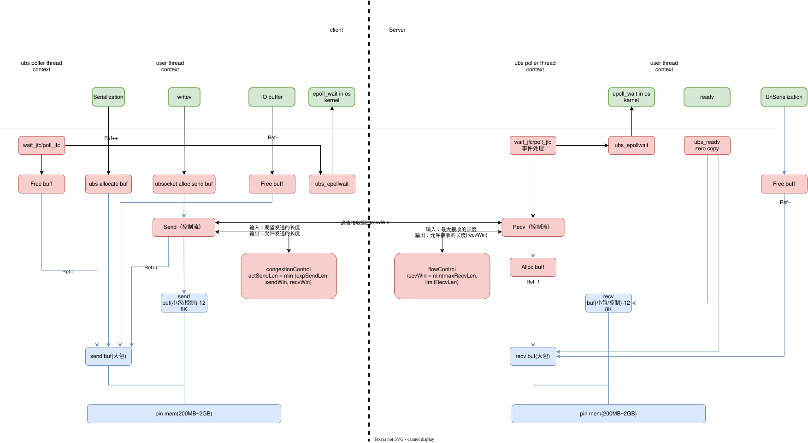

# ubsocket-flow-control

## 1 流控框架

    UBSocket连接的流量流控对象是发送和接收内存，在有限的内存下最小化通信时延，在不同包长、QPS、并发包数的不同连接下，降低连接间时延相互影响，防止大流吃小流。UBSocket连接的流量由发送窗口和接收窗口控制，主要定义窗口的控制和交互逻辑。发送窗口计算公式由拥塞控制算法决策，接收窗口由接收端流量控制算法决策。

说明：
> - 流控框架提供发送窗口和接收窗口交互流程，具体窗口计算由具体算法实现
> - 在零拷贝的发送方向，发送缓存内存由应用直接申请，因为不能改变应用语义，流控框架不做限制，这里对不同连接内存的影响需要申请者控制。
> - 流控框架支持不同算法插件化扩展。

### 1.1 流控消息交互说明

//TO DO: 待给出流控控制消息流，包含read、write、send、recv等消息收发

### 1.2 零拷贝内存控制

//TO DO: 待给出应用直接申请的内存，如何影响总内存。

## 2 流控算法
    //TO DO: UBSocket连接流控算法需要基于URMA流控算法的规格和约束来设计，最大化利用硬件流控能力。

### 2.1 接收流量控制算法
//TODO

### 2.2 发送拥塞控制算法
//TODO

## 3 参考
### 3.1 URMA流控算法
当前`URMA`支持多种流控机制，参见 [over_urma/ubsocket-flow-control.md](over_urma/ubsocket-flow-control.md)，流控算法基于URMA流控机制设计，不同方案使用不同的URMA语义，可用的流控机制不同。比如`UMQ`使用`URMA`的双边消息，基于信用量流控(`credit`)。

**流控机制对比总表**

| 机制 | 层次 | 适用范围 | 触发条件 | 控制粒度 | 延迟影响 | 是否涉及网络 |
|---|---|---|---|---|---|---|
| RNR 重试 | 硬件链路层 | 所有操作 | 接收端 JFR 满 | 包级别 | 中等（ms 级） | ✅ RNR NACK |
| 信用量流控 | 传输层 | UMQ 双边 SEND/RECV | 信用量耗尽 | 消息级别 | 低（μs 级） | ✅ IMM 消息 |
| JFS/JFR Depth | 排队层 | 所有操作 | 队列满 | WR 级别 | 无（本地排队） | ❌ |
| err_timeout | 链路层 | RC/RM 可靠模式 | 网络故障 | 连接级别 | 高（数百 ms） | ✅ ACK 超时 |
| UMS 信用量 | 传输层 | UMS socket | 信用量耗尽 | 消息级别 | 低 | ✅ CDC 消息 |
| 速率限制 | 应用层 | perftest 工具 | 时间窗口 | 字节/包级别 | 无（本地等待） | ❌ |

**适用操作类型**

| 操作 | RNR | 信用量流控 | JFS Depth | err_timeout |
|---|---|---|---|---|
| SEND（双边） | ✅ | ✅ | ✅ | ✅ |
| RECV（双边） | 发射 RNR | 接收端 pool | JFR 满 | N/A |
| WRITE（单边） | ✅ | ❌ | ✅ | ✅ |
| READ（单边） | ✅ | ❌ | ✅ | ✅ |
| ATOMIC | ✅ | ❌ | ✅ | ✅ |