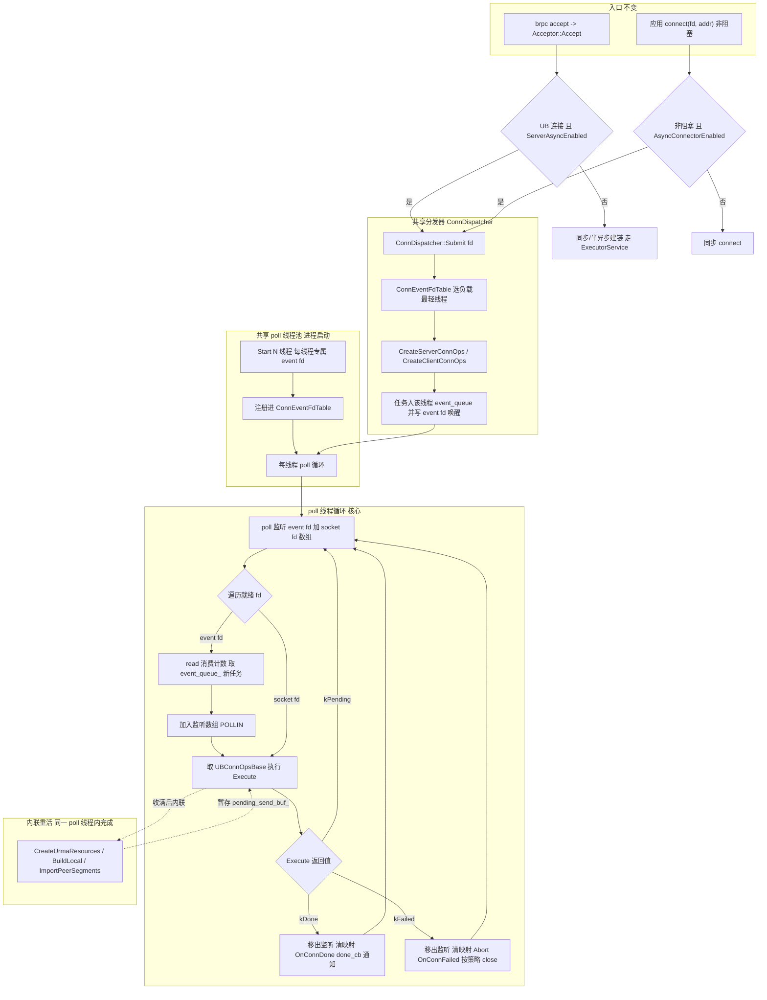
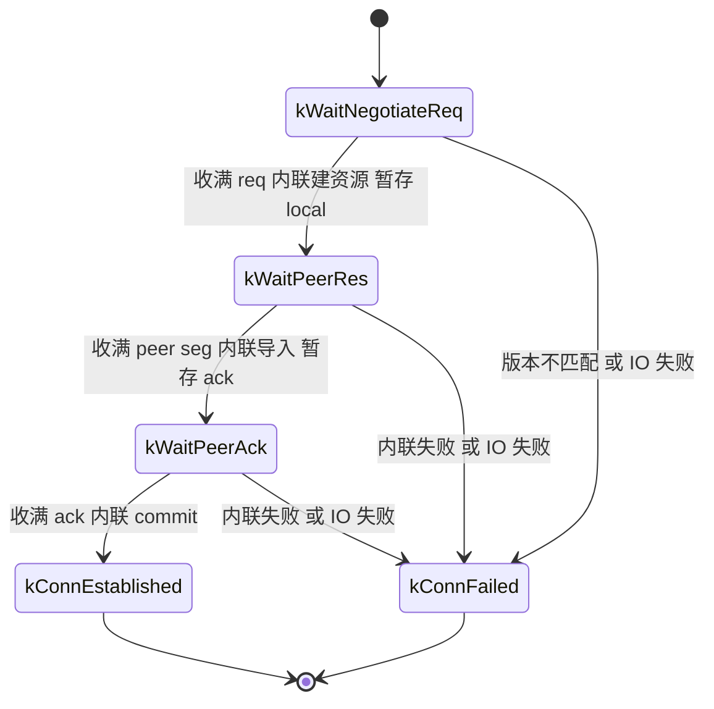

# UBSocket Server 侧全异步建链设计文档

> **版本说明（统一共享池 + 两侧内联重活）**：本文档描述**当前目标设计**——Server 与 Client 共用一个
> 进程级全异步建链 poll 线程池（`ConnDispatcher`），且**两侧都把 ms 级 URMA 重活内联在 poll 线程执行**。
> 相对上一版（`SubmitHeavyWork` 卸载到共享 `ExecutorService` + `completion_queue_` 回投）本版：
> 取消重活卸载层，删除 `ConnStageResult::kHeavyPending`、`ServerConnState::kCreatingResources` /
> `kImportingJetty`、`completion_queue_`、`HeavyDoneCallback`、`SubmitHeavyWork`、`RunHeavyWork`，
> 全异步 server 不再启停 `ExecutorService`。Server 状态机与 Client 同构：`recv 等待态 + 收满内联重活 +
> pending_send_buf_ 非阻塞续发`。
>
> **为什么现在可以内联**：早期迫使卸载的"对端 10ms rsp 预算"已被超时拆分消除——
> `NEGOTIATE_REPLY_TIMEOUT_MS = 2000`（`ubsocket_defines.h:199`）专门给客户端等 rsp 留 2s，
> `NEGOTIATE_ACCEPT_TIMEOUT_MS = 10` 只用于服务端**同步/半异步** worker。内联后真正剩余的约束是
> 段交换预算 `CONTROL_PLANE_TIMEOUT_MS = 2000`，靠 poll 线程数配够来满足（见 §2.3）。
>
> **共享层归属**：通用 poll 线程池、通用状态机基类、通用 event fd 表由本文件定义（`ConnReactorThread` /
> `ConnDispatcher` / `ConnEventFdTable` / `UBConnOpsBase`），Client 侧设计文档
> `UBSOCKET-CLIENT-ASYNC-CONN-DESIGN.ch.md` 复用同一套设施，不再自建池。
>
> **线程数配置（本版决策）**：把原 `UBS_SERVER_HANDLER_NUM`（env `UBSOCKET_SERVER_ASYNC_HANDLER_NUM`）
> 重命名为 `UBS_CONN_POLL_THREAD_NUM`（env `UBSOCKET_CONN_POLL_THREAD_NUM`，默认 1），作为 **Server/Client
> 共用的全异步 poll 线程池数量**（单一旋钮，不再 `max` 合并）。`UBS_THREAD_POOL_SIZE` 恢复为**半异步
> accept / `ExecutorService` 专属**，语义不变；半异步路径与 `ExecutorService` 生命周期**完全不动**，
> 本版只改全异步 server/client 两侧。

## 1. 文档信息

| 项目 | 内容 |
|------|------|
| 需求 | UBSocket Server/Client 侧建链全异步化，统一共享 poll 线程池 + 两侧内联重活 |
| 目标传输层 | URMA（`csrc/core/urma/`，唯一 UB 传输后端） |
| Server 开关 | `ubsocket_server_async_enable`（`ServerAsyncEnabled()`） |
| Client 开关 | `u_init_options_t::async_connector_enable`（bool，`AsyncConnectorEnabled()`） |
| poll 线程数 | `GlobalSetting::UBS_CONN_POLL_THREAD_NUM`（env `UBSOCKET_CONN_POLL_THREAD_NUM`，默认 1），Server/Client 共用 |
| 重活执行 | **无独立/共享重活池**：URMA 本地重活在 poll 线程内联执行 |
| 半异步 / ExecutorService | **本版不改**：`UBS_THREAD_POOL_SIZE` 与 `Acceptor::InitWakeupEvent` 原样保留 |
| 共享池启动条件 | `ServerAsyncEnabled() || AsyncConnectorEnabled()` |
| 设计原则 | 不改变建链协议与 brpc 侧 accept 语义，通过开关切换新老路径 |

## 2. 背景与目标

### 2.1 背景与演进

早期 Server 侧建链把整个建链流程封装成阻塞任务提交线程池，每连接独占 worker 等对端回复，线程利用率低。
后续改造为全异步状态机：poll 线程以 recv 为界驱动多个连接。当时测试发现若把 URMA 资源创建等 ms 级重活
**内联**在 poll 线程，单线程并发建链 1000/10000 条时被重活串行化拖住，对端等 rsp（当时为 10ms）超时先
close，服务端发 local seg 撞 `EPIPE`（`UBS_TCP_EXCHANGE`）。为此引入 `SubmitHeavyWork` 把重活卸载到共享
`ExecutorService`。

该方案的代价：多一套重活在途状态（`kCreatingResources` / `kImportingJetty`）、`completion_queue_` +
eventfd 自旋保不丢、executor 线程与 poll 线程并发改同一 socket 的竞态面，以及 server/client 各自
建池的线程冗余。随着客户端 rsp 预算从 10ms 放宽到 2s（`NEGOTIATE_REPLY_TIMEOUT_MS`），**卸载的唯一硬
理由已消失**，故本版回到统一的内联模型并让 Server/Client 共用同一个 poll 池。

### 2.2 目标

- **统一共享池**：进程内只保留一个全异步建链 poll 线程池，Server（accept 侧）与 Client（connect 侧）
  连接都投递到同一个池，按统一负载均衡选线程。
- **两侧内联重活**：poll 线程收满一帧后**在同一次 `Execute()` 内**内联执行本地重活，不切换线程。
  "异步"只针对 **IO 层面**——只有涉及网络交互（send/recv）的阶段才需要非阻塞，其余全部在当前 poll
  线程内完成。
- **通用层抽公共基类**：`UBConnOpsBase` 承载 fd / `AsyncConnBuffer` / `Abort` / `WantsWritable` /
  `SendControlNonBlocking` / `FlushPendingSend` / `pending_send_buf_` / 超时与 close 策略。
- **不引入重活池**：全异步路径不再启停 `ExecutorService`；`ExecutorService` 仅供**半异步 accept**
  （`AsyncAcceptorEnabled`）使用。半异步路径与其 `ExecutorService` 生命周期**保持现状、不做任何改动**。
- **单一 poll 线程旋钮**：`UBS_CONN_POLL_THREAD_NUM` 同时服务 server 与 client，不引入第二个旋钮。
- 不改变建链协议（NegotiateReq/rsp、段信息交换、ack 不变）。

### 2.3 内联的吞吐约束（必读）

内联后单 poll 线程串行推进多个连接的重活，必须满足：

```
(单线程在途连接数) 乘 (单次重活耗时)  <  对端单阶段预算
```

- 对端段交换预算 `CONTROL_PLANE_TIMEOUT_MS = 2000ms`（`ubsocket_defines.h:192`）。
- 对端等 rsp 预算 `NEGOTIATE_REPLY_TIMEOUT_MS = 2000ms`，但 rsp 本身是轻量发送、不含重活，故 rsp 路径
  基本无风险。
- 因此**线程数是硬约束**：`ConnPoolSize` 必须随并发建链规模放大。原实测 1000 并发、单线程内联
  ≈ 5s+ 会超 2s；若每线程重活均值 t ms，则至少需要 `并发数 乘 t / 2000` 个线程。
- 缓解措施：对单次重活耗时打点（复用 `PROF_RECORD`，见 §7.5），据实测反推线程数；仍不足时再评估
  "每连接独立线程"或按需卸载，不改动协议与状态机骨架。
- 内联重活**绝不包含阻塞 send/recv**：只调用 `CreateResourcesAndStageLocal` /
  `ImportPeerAndStageAck` 等本地方法，控制面帧一律暂存 `pending_send_buf_` 交由非阻塞续发。

## 3. 统一架构

### 3.1 共享 vs 专属

| 组件 | 归属 | Server/Client 差异 |
|------|------|--------------------|
| `ConnReactorThread` | 共享 | 无差异：poll 循环、event fd、fd 槽位、`event_queue_` |
| `ConnDispatcher` | 共享 | 无差异：按负载选线程、`Submit` / `Cancel` |
| `ConnEventFdTable` | 共享 | 无差异：统一最轻负载均衡 |
| `UBConnOpsBase` | 共享 | close/超时策略经虚函数区分 |
| `ConnStageResult` | 共享 | 仅 `kPending` / `kDone` / `kFailed` |
| `UBServerConnOps` | server | accept 侧状态机（3 阶段） |
| `UBClientConnOps` | client | connect 侧状态机（4 阶段，含 TCP 握手） |
| `UrmaServerConnOps` | urma | server 派生实现 |
| `UrmaClientConnOps` | urma | client 派生实现 |

依赖方向：通用层（`core/ubsocket_conn_*.{h,cpp}`）不得 `#include "urma/..."`；具体实现经
工厂 `SocketBase::CreateServerConnOps` / `CreateClientConnOps` 创建。

### 3.2 组件总览

| 组件 | 层级 | 职责 |
|------|------|------|
| `ConnStageResult` | 通用 | 阶段执行结果枚举（`kPending` / `kDone` / `kFailed`） |
| `AsyncConnBuffer` | 通用 | 每连接非阻塞增量读缓冲（`CONN_CTRL_BUF_SIZE = 512`） |
| `UBConnOpsBase` | 通用 | Server/Client 状态机公共基类（fd / 缓冲 / 续发 / Abort / 超时 / close 策略） |
| `ConnEventFdTable` | 通用 | 全局 event fd 注册表（thread event fd -> 负载），统一负载均衡 |
| `ConnReactorThread` | 通用 | poll 线程：专属 event fd + `event_queue_` + 监听 fd 数组；**无 completion 队列** |
| `ConnDispatcher` | 通用 | 分发器：启动共享 poll 池、按负载最轻唤醒线程、`Submit` / `Cancel` |
| `UBServerConnOps` | 通用（基类）+ URMA（派生） | Server 建链状态机（recv 在 poll、收满内联重活） |
| `UBClientConnOps` | 通用（基类）+ URMA（派生） | Client 建链状态机（非阻塞 TCP 握手 + recv + 内联重活） |

### 3.3 执行模型：poll 线程内联重活 + 非阻塞 IO

一次 `Execute()` 的通用形态（Server/Client 同构）：

```
Execute()  [运行于共享 poll 线程]
  ├─ 若 pending_send_buf_ 非空：FlushPendingSend()        // 非阻塞续发
  │    └─ EAGAIN -> 置 wants_writable_，返回 kPending（reactor 追加 POLLOUT）
  ├─ 非阻塞增量 recv 对端本阶段消息
  │    └─ 半包(EAGAIN) -> 返回 kPending（fd 保留在监听数组）
  ├─ 收满 -> 在当前线程内联执行本地重活（建资源 / 导入对端 / 收尾）
  │    ├─ 失败 -> 返回 kFailed
  │    └─ 成功 -> 把下一阶段待发帧暂存 pending_send_buf_，切 state_
  └─ 返回 kPending（下一阶段由后续 POLLIN/POLLOUT 驱动）
```

关键点：
- **重活只在 recv 收满后执行**，且**只调用本地方法**，不发起任何阻塞 IO。
- 重活结果若需发送，**不在重活内发送**，而是暂存 `pending_send_buf_`，由后续 `Execute()` 非阻塞续发。
- 由于重活在 poll 线程内联，**不存在"重活在途"状态**，`Execute()` 返回时 `state_` 必定是某个"等待
  recv"态或终态。

### 3.4 总体架构



**读图要点**：Server/Client 只共享"分发器 + poll 池 + 通用基类"；两侧的重活都在 `Execute()` 内联，
不产生跨线程完成通知，因此没有 `completion_queue_`。

## 4. 协议序列（现状）

### 4.1 Server 侧 URMA 控制面序列

| 序号 | 方向 | 内容 | 格式 | 异步化后执行线程 |
|------|------|------|------|------------------|
| R1 | recv | `UrmaNegotiateReq` | `[4B body_len][body]`（LengthPrefixed） | poll |
| S_rsp | send | `UrmaNegotiateRsp` | `[4B body_len][UrmaNegotiateRsp]`（major mismatch 改发 4B `mismatch_version`） | poll（非阻塞续发） |
| L1 | 本地 | EnsureSocketCreated + ApplyNegotiatedConfig + CreateUrmaResources + 组 local seg | — | **poll 内联** |
| S_local | send | local seg | 裸 `UrmaSockSegExInfo`（~408B） | poll（非阻塞续发） |
| R2 | recv | peer seg | 裸 `UrmaSockSegExInfo` | poll |
| L2 | 本地 | RegisterSocket（ArraySet，轻量）+ ImportPeerSegments | — | **poll 内联** |
| S_ack | send | ack | 裸 `Result`（4B） | poll（非阻塞续发） |
| R3 | recv | peer_ret | 裸 `Result`（4B） | poll |
| L3 | 本地 | CommitRemotePeer + 置 `SOCK_STAT_ESTABLISHED` | — | **poll 内联** |

> URMA 控制面**无 magic**：`ValidateProtocol` 空实现，状态机直接从阶段一（等 NegotiateReq）开始。
> 对照上一版：L1 / L2 从"共享 executor"改为"poll 内联"，其余不变。

### 4.2 三阶段拆分

建链以 recv 对端消息为界拆为 3 个阶段；每阶段内先由 poll 线程收帧 + 轻量应答，读满后**在同一 poll
线程内联执行重活**：

| 阶段 | 状态 | poll 动作 | 收满后内联重活 |
|------|------|-----------|----------------|
| 阶段一 | `kWaitNegotiateReq` | 收 R1 + 内联回 S_rsp | EnsureSocketCreated + ApplyConfig + CreateUrmaResources + BuildLocal（暂存 S_local） |
| 阶段二 | `kWaitPeerRes` | 续发 S_local + 收 R2 + 内联 RegisterSocket | ImportPeerSegments（暂存 S_ack） |
| 阶段三 | `kWaitPeerAck` | 续发 S_ack + 收 R3 | CommitRemotePeer + ESTABLISHED |

## 5. 总体设计

### 5.1 可复用的既有设施

| 设施 | 位置 | 复用方式 |
|------|------|----------|
| `ServerConnReactorThread` | `ubsocket_server_conn_reactor.h:79` | 泛化为 `ConnReactorThread`（poll 循环、fd 槽位、event 队列）；**去掉 completion 队列** |
| `ServerConnDispatcher` / `ServerConnEventFdTable` | 同上 `:150` / `:38` | 泛化为 `ConnDispatcher` / `ConnEventFdTable`，Server/Client 共用一个实例 |
| `UBServerConnOps` 基类 | `ubsocket_server_conn_ops.h:34` | 抽取公共基类 `UBConnOpsBase`（fd / `AsyncConnBuffer` / `Abort` / `WantsWritable` / `SendControlNonBlocking` / `FlushPendingSend`）；**去掉 `SubmitHeavyWork` / `HeavyDoneCallback` / `RunHeavyWork`** |
| `AsyncConnBuffer` | `ubsocket_server_conn_buffer.h:26` | 非阻塞增量收帧，直接复用 |
| `ConnStageResult` | `ubsocket_server_conn_types.h:55` | 保留 `kPending` / `kDone` / `kFailed`；**删除 `kHeavyPending`** |
| `SendControlNonBlocking` / `FlushPendingSend` | `urma_server_conn_ops.cpp:186/217` | 上移到 `UBConnOpsBase`，Server/Client 共用 |
| `NotifyWritable` 链路 | `ubsocket_socket.h:232` -> `DoNotifyWritable` `:252` | 建链成功向应用注入 `EPOLLOUT`（Client 侧） |
| ~~`ExecutorService`~~ | ~~`ubsocket_thread_pool.h`~~ | **全异步建链不再使用**；半异步 accept 继续使用，其启停逻辑**原样不动** |

### 5.2 执行线程归属

| 动作 | 执行线程 |
|------|----------|
| TCP 握手 / 版本协商 recv / 段交换 recv / ack recv | 共享 poll 线程 |
| 控制面 send（rsp / local seg / ack） | 共享 poll 线程（非阻塞续发） |
| URMA 资源创建 / 对端导入 / commit | 共享 poll 线程（内联） |
| accept 完成通知（ready_queue + wakeup_event） | 共享 poll 线程（`OnConnDone` -> done_cb） |
| connect 完成通知（延迟 epoll 注册 + EPOLLOUT） | 共享 poll 线程（`OnConnDone`） |

## 6. 核心类型设计

### 6.1 状态与返回值枚举

`ConnStageResult`（共享，`ubsocket_conn_types.h`）：

```cpp
enum class ConnStageResult : uint8_t {
    kPending = 0, // 本阶段 recv 半包或非阻塞续发 EAGAIN，fd 保留在监听数组
    kDone,        // 建链完成，fd 移出监听 + 通知用户
    kFailed,      // 建链失败，fd 移出监听 + 清映射 + 按策略 close
};
```

`ServerConnState`（server，`ubsocket_server_conn_types.h`）：

```cpp
enum class ServerConnState : uint8_t {
    kWaitNegotiateReq = 0, // 阶段一：等 UrmaNegotiateReq（recv，poll）
    kWaitPeerRes,          // 阶段二：等对端 UrmaSockSegExInfo（recv，poll）
    kWaitPeerAck,          // 阶段三：等对端 peer_ret ack（recv，poll）
    kConnEstablished,      // 建链完成（终态）
    kConnFailed,           // 建链失败（终态）
};
```

对照上一版：**删除** `kCreatingResources` / `kImportingJetty`。`ClientConnState` 见 Client 设计文档。

> 空闲超时 `SERVER_CONN_IDLE_TIMEOUT_MS = 10000`（10s）：须显著大于对端单阶段阻塞预算
> `CONTROL_PLANE_TIMEOUT_MS = 2000`；由于无重活在途态，超时扫描不再需要跳过任何状态。

### 6.2 AsyncConnBuffer（`ubsocket_server_conn_buffer.h/.cpp`）

非阻塞增量读缓冲（`CONN_CTRL_BUF_SIZE = 512`）：`Advance` 循环 `recv` 到期望长度、`EAGAIN` 不阻塞返回
已读字节；`Consume` 保留多读字节供下一阶段；全程不调用 `poll()`。

### 6.3 UBConnOpsBase（`ubsocket_conn_ops_base.h/.cpp`）

Server/Client 状态机公共基类，承载 fd / 缓冲 / 续发 / 中止 / 超时 / close 策略：

```cpp
class UBConnOpsBase : public std::enable_shared_from_this<UBConnOpsBase> {
public:
    virtual ~UBConnOpsBase() = default;

    /* poll 线程唯一入口：按 state_ 分发到对应阶段（各派生类实现）。
     * effective_now_ms 由 reactor 传入 = 墙钟 - 本线程累计内联重活耗时（见 §7.7），
     * 进入时据此刷新 last_active_ms_。 */
    virtual ConnStageResult Execute(uint64_t effective_now_ms) = 0;

    void Abort();                       /* poll 在失败/Stop 时调用，后续阶段据此停止推进 */
    bool IsAborted() const;

    /* EAGAIN 续发：poll 返回 kPending 前置位，reactor 据此为该 fd 追加 POLLOUT */
    bool WantsWritable() const;

    /* 最近一次 Execute 的有效时刻（已扣除本线程内联重活耗时）；仅 poll 线程读写 */
    uint64_t LastActiveMs() const;

    /* 每连接空闲超时阈值（server=10s，client 见 Client 文档） */
    virtual uint64_t IdleTimeoutMs() const = 0;

    /* 失败收尾是否由 reactor close(fd)：server=true（fd 自 accept 所得），client=false（fd 归应用） */
    virtual bool CloseOnFailure() const = 0;

    virtual void OnConnDone() {}        /* 成功收尾钩子：注册 epoll / 置 ESTABLISHED / 通知应用 */
    virtual void OnConnFailed() {}      /* 失败收尾钩子：清 ArraySet / remote 段 / 记 connect_error_ */

    int Fd() const;
    const struct sockaddr &Addr() const;
    socklen_t AddrLen() const;

protected:
    Result SendControlNonBlocking(const void *data, size_t size, size_t &sent);
    Result FlushPendingSend();          /* 非阻塞续发 pending_send_buf_，EAGAIN 置 wants_writable_ */

    int fd_;
    struct sockaddr addr_;
    socklen_t addr_len_ = 0;
    AsyncConnBuffer buf_;
    std::vector<uint8_t> pending_send_buf_;   /* 阶段间待发控制面帧（非阻塞续发） */
    size_t pending_send_off_ = 0;
    uint64_t last_active_ms_{0};              /* 有效时钟；仅 poll 线程访问，无需 atomic */
    std::atomic<bool> aborted_{false};
    bool wants_writable_ = false;             /* 仅 poll 线程访问 */
};
```

> **无** `SubmitHeavyWork` / `HeavyDoneCallback` / `heavy_submit_ns_` / `RunHeavyWork` /
> `completion_queue_` / `state_` 的"重活在途"值。

### 6.4 ConnReactorThread / ConnDispatcher / ConnEventFdTable

`ConnReactorThread` 由 `ServerConnReactorThread` 泛化而来，仅保留 poll 循环所需：

```cpp
class ConnReactorThread {
public:
    using DoneCallback = std::function<void(int fd, const struct sockaddr &addr, socklen_t addr_len)>;

    Result Init(int thread_index);
    Result AddConnection(int fd, const std::shared_ptr<UBConnOpsBase> &ops, const DoneCallback &done_cb);
    void Stop();
    int EventFd() const;

private:
    void RunLoop();
    void HandleEventFd();
    void HandleSocketFd(int fd);
    void AddPollFd(int fd, short events);
    void RemovePollFd(int fd);
    void FinishConnection(int fd, ConnStageResult result);
    void ScanTimeoutConnections();
    uint64_t EffectiveNow() const;                     /* GetTimeMs() - busy_ms_，见 §7.7 */

    static constexpr int kPollTimeoutMs = 100;
    static constexpr uint64_t kEventQueueCapacity = 8192;
    static constexpr uint64_t kScanIntervalMs = 1000;

    int event_fd_ = -1;
    std::thread thread_;
    std::vector<struct pollfd> poll_fds_;              /* 槽0 固定 event fd，惰性删除置 fd=-1 */
    std::unordered_map<int, ConnEntry> conn_ops_map_;
    std::mutex conn_map_mutex_;
    MPSCRingQueue<int> event_queue_{kEventQueueCapacity};  /* 无 completion_queue_ */
    std::atomic<bool> started_{false};
    std::atomic<bool> stopped_{false};
    uint64_t last_scan_ms_ = 0;
    uint64_t busy_ms_ = 0;      /* 累计"处理就绪 fd"耗时（内联重活为主），仅 poll 线程访问，见 §7.7 */
};
```

`ConnDispatcher`（共享）与 `ServerConnDispatcher` 同构，但：
- `Start(num_threads)` **不再启停 `ExecutorService`**；
- `Stop()` **不再停止 `ExecutorService`**；
- `Submit(fd, addr, addr_len, done_cb, ops_factory)` 需要能创建 server 或 client 两种 ops——建议由调用方
  先经工厂创建 `UBConnOpsBase` 再传入，或提供 `SubmitServer` / `SubmitClient` 两个薄封装。

`ConnEventFdTable` 即原 `ServerConnEventFdTable` 重命名，逻辑不变（统一负载均衡）。

### 6.5 UBServerConnOps（`ubsocket_server_conn_ops.h/.cpp`）

```cpp
class UBServerConnOps : public UBConnOpsBase {
public:
    UBServerConnOps(int fd, const struct sockaddr &addr, socklen_t addr_len);
    ConnStageResult Execute(uint64_t effective_now_ms) override;   // 按 state_ 分发
    uint64_t IdleTimeoutMs() const override { return SERVER_CONN_IDLE_TIMEOUT_MS; }
    bool CloseOnFailure() const override { return true; }  // fd 自 accept 所得，失败时由 reactor close
    void OnConnFailed() override {}              // 派生类清理 ArraySet / remote 段

protected:
    virtual ConnStageResult DoWaitNegotiateReq() = 0;
    virtual ConnStageResult DoWaitPeerRes() = 0;
    virtual ConnStageResult DoWaitPeerAck() = 0;

    std::atomic<ServerConnState> state_{ServerConnState::kWaitNegotiateReq};
};
```

- `Execute(effective_now_ms)` 用有效时钟刷新 `last_active_ms_` 后按 `state_` 分发；内联重活期间不返回，
  故无 `kHeavyPending`。
- 内联重活失败即置 `kConnFailed` 并返回 `kFailed`。

### 6.6 UrmaServerConnOps（`urma_server_conn_ops.h/.cpp`）

- `EnsureSocketCreated`（poll 内联）：建 `UrmaSocket`（SocketBase::Create + `Initialize` 分配收发缓冲）+
  eventfd + `GenerateSocketCommOps` + 置 `create_type_=ACCEPT`。`sock_` 非空时幂等返回。
- `DoWaitNegotiateReq`（poll，阶段一）：`TryRecvNegotiateReq` 增量读 req -> `BuildNegotiateReply` 暂存
  rsp -> `FlushPendingSend`（EAGAIN 返回 `kPending`）-> **内联 `CreateResourcesAndStageLocal`**（EnsureSocketCreated +
  ApplyNegotiatedConfig + CreateUrmaResources + BuildLocalSegExInfo，暂存 local seg）-> `kWaitPeerRes`。
- `DoWaitPeerRes`（poll，阶段二）：续发 local seg -> 增量读 peer seg -> 内联 `RegisterSocket` -> **内联
  `ImportPeerAndStageAck`**（ImportPeerSegments，暂存 ack）-> `kWaitPeerAck`。
- `DoWaitPeerAck`（poll，阶段三）：续发 ack -> 读满 peer_ret -> 内联 `CommitRemotePeer` +
  置 `SOCK_STAT_ESTABLISHED` + 恢复阻塞态 -> `kDone`。
- `OnConnFailed`：`registered_` 时清 `ArraySet`；`peer_imported_` 时 `rm_remote_segments` 对齐同步路径。

> 与上一版代码差异：`DoWaitNegotiateReq` / `DoWaitPeerRes` 末尾不再 `SubmitHeavyWork` 返回
> `kHeavyPending`，而是直接调用原重活方法并切到下一状态；`CreateResourcesAndStageLocal` /
> `ImportPeerAndStageAck` 保留（仅改由 poll 线程调用），`RunHeavyWork` 相关全部删除。

## 7. 执行模型

### 7.1 初始化（进程启动）

`ubsocket_init`（`ubsocket.cpp:55`）在 `UrmaBackend::Init()` 之后：

```cpp
if (GlobalSetting::ServerAsyncEnabled() || GlobalSetting::AsyncConnectorEnabled()) {
    result = ConnDispatcher::Instance().Start(GlobalSetting::UBS_CONN_POLL_THREAD_NUM);
    /* 失败可回退：server 回退同步 accept，client 回退同步 connect */
}
```

- `ConnDispatcher::Start` 只创建 poll 线程、注册 `ConnEventFdTable`，**不启动 `ExecutorService`**。
- `ExecutorService` 仍由半异步 accept 的 `Acceptor::InitWakeupEvent` 懒启动（`AsyncAcceptorEnabled` 时），
  **逻辑原样保留**。全异步 server 侧需从 `InitWakeupEvent` 的启动条件里摘掉 `ServerAsyncEnabled`
  （即改为仅 `AsyncAcceptorEnabled()`），因为全异步不再用它——这属于"改全异步 server 侧"，不改半异步行为。

### 7.2 poll 线程数：单一旋钮

`ConnDispatcher::Start` 直接使用 `UBS_CONN_POLL_THREAD_NUM`（原 `UBS_SERVER_HANDLER_NUM` 重命名），
Server/Client 共用同一数值，**不做 `max`/`sum` 合并**：

```
poll_threads = UBS_CONN_POLL_THREAD_NUM   // env UBSOCKET_CONN_POLL_THREAD_NUM，默认 1
```

- 旧 `UBS_SERVER_HANDLER_NUM`（env `UBSOCKET_SERVER_ASYNC_HANDLER_NUM`）重命名而来，语义由"重活
  executor 线程数"变为"全异步 poll 线程数"；旧 env 可作为 deprecated alias 兼容（读取时告警）。
- `UBS_THREAD_POOL_SIZE`（env `UBSOCKET_ASYNC_ACCEPT_THREAD_NUM`）不再参与全异步 poll 线程数，
  回归半异步 accept / `ExecutorService` 专属。
- 因重活内联，`poll_threads` 必须满足 §2.3 的吞吐约束。

### 7.3 分发

`ConnDispatcher::Submit`：`ConnEventFdTable::GetLeastLoaded()` 取负载最轻 event fd -> `FindThread` 定位
poll 线程 -> 调用方经工厂 `SocketBase::CreateServerConnOps` / `CreateClientConnOps` 创建 `UBConnOpsBase`
-> `thread->AddConnection(fd, ops, done_cb)`（加锁插入 `conn_ops_map_` -> `IncLoad` -> fd 置非阻塞 ->
任务入 `event_queue_` -> write event fd 唤醒）。

- Server 的 `done_cb`：push `ready_queue` + `WakeUpReadyEventFd`（`OnConnDone` 后由 reactor 调用）。
- Client 的 `done_cb`：可为空（完成通知由 `UBClientConnOps::OnConnDone` 内的延迟 epoll 注册完成）。

### 7.4 poll 线程循环

1. 初始化 poll 只监听 event fd。
2. 分发器写 event fd -> poll 被唤醒；遍历就绪 fd：
   - **event fd**（`HandleEventFd`）：`read` 消费计数 -> 取 `event_queue_` 中所有新任务 -> 加入监听数组
     监听 `POLLIN` -> 逐个执行一次建链任务。
   - **socket fd**（`HandleSocketFd`）：取 `UBConnOpsBase::Execute(EffectiveNow())`，按返回值处置：
     - `kPending`：fd 保留监听（`WantsWritable()` 时追加 `POLLOUT`）；
     - `kDone` / `kFailed`：`FinishConnection` 移出监听并收尾。
3. **有效时钟记账**：每轮 poll 返回后记 `t1`，处理完所有就绪 fd 记 `t2`，`busy_ms_ += (t2 - t1)`。
   这段时间是本线程花在"处理其它连接（含内联重活）"上的，**不计入任何连接的空闲**（见 §7.7）。
   poll 等待时间（`t1 - t0`）是真正的空闲等待，照常计入。
4. poll 带 100ms 超时，用于周期性空闲扫描。

> 无 `kHeavyPending` 分支，`completion_queue_` 不再存在。

### 7.5 内联重活

- 内联重活在 `DoWaitXxx` 内直接调用本地方法（`CreateResourcesAndStageLocal` /
  `ImportPeerAndStageAck` / `CommitRemotePeer`），**不发起阻塞 IO**。
- 发送一律"暂存 `pending_send_buf_` + 后续 `Execute()` 非阻塞续发"，与既有 `DoWaitPeerRes` 先
  `FlushPendingSend` 再 recv 同款。
- 建议对单次重活耗时打点（`PROF_RECORD`，如 `SERVER_CONN_HEAVY_CREATE_RES` /
  `SERVER_CONN_HEAVY_IMPORT`）以反推线程数；原"排队等待"指标 `SERVER_CONN_HEAVY_QUEUE` 失去意义可删。

### 7.6 建链完成 / 失败清理（`FinishConnection`）

```
RemovePollFd -> 加锁 move 出 ConnEntry 并 erase（先清表）-> DecLoad
kDone:   ops->OnConnDone();  if (done_cb) done_cb(fd, ops->Addr(), ops->AddrLen());   // 不 close
kFailed: ops->Abort(); ops->OnConnFailed(); if (ops->CloseOnFailure()) LibcApi::close(fd);
```

- `CloseOnFailure()` 把 close 策略下放：server 返回 `true`（accept fd 自持），client 返回 `false`
  （fd 归应用，POSIX 下由应用 close）。
- 失败时 `Abort()` 仅用于阻止后续阶段推进，无需等待在途重活（重活已内联完成）。

### 7.7 空闲超时扫描（有效时钟，排除内联重活耗时）

**问题**：内联重活会长时间占用 poll 线程。若空闲扫描用墙钟比较，则线程忙于 A/C/D 的内联重活时，正在等
对端数据的 B 的 `last_active` 得不到刷新，可能在**线程被其它连接占满 > `IdleTimeoutMs()`** 时被误杀
（默认 poll 线程数 1 时尤甚）。原 Server 方案靠"重活态不参与扫描"规避，内联后该保护消失。

**方案**：给每个 poll 线程维护一个"有效时钟"，只累计**真正空闲等待**的时间，扣除花在其它连接上的
处理耗时：

```cpp
uint64_t ConnReactorThread::EffectiveNow() const { return SocketConnHelper::GetTimeMs() - busy_ms_; }
```

- `busy_ms_` 仅由 poll 线程在每轮处理就绪 fd 后累加（见 §7.4 步骤 3），无需锁。
- `Execute(effective_now_ms)` 进入时执行 `last_active_ms_ = effective_now_ms`。
- `ScanTimeoutConnections` 用 `effective_now = EffectiveNow()`，判据：
  `last_active_ms_ != 0 && (effective_now - last_active_ms_) > ops->IdleTimeoutMs()`。
- 数学上，连接的空闲 = `(t_scan - t_refresh) - (busy(t_scan) - busy(t_refresh))`，即**扣除了期间本线程
  的内联重活耗时**；线程空转在 poll 里等待的时间照常累计。
- `last_active_ms_` 现仅 poll 线程读写，去掉 `std::atomic`（见 §6.3）。
- 因无重活在途态，**不再跳过任何状态**。

> **代价**：若某线程持续被内联重活占满，其上连接的"死连接"检测会被推迟。可接受——真正死连接由对端
> close 触发 `recv=0` 快速回收，空闲扫描仅兜底"对端开着但静默"的泄漏连接。此处**宁可晚杀也不误杀**。

### 7.8 取消 / close（client 特有，server 侧由 acceptor 关闭）

`ConnDispatcher::Cancel(fd)`：置 ops `Abort()`；从 poll 移除、从 map 删除、队列中 fd 惰性丢弃。ops 持
`SocketPtr`（client）保活，应用先 `close` 也不会释放对象。Server 侧连接 fd 由 acceptor/自身持有，失败即
close，无需 `Cancel` 的保活语义（但仍可复用同一接口）。

### 7.9 反初始化（`ubsocket_uninit`）

`ConnDispatcher::Stop()` 放资源回收最前（`ubsocket.cpp:250` 附近）：先逆序 `Stop()` 各 poll 线程（join），
再走原有 `TxCqePoller::Stop` / `ArraySet::ReleaseAll` / `EpollRunner::Stop` / backend `UnInit` 顺序。
`Stop()` 幂等，开关关闭时 no-op。**不再调用 `ExecutorService::Stop()`**。

> 半异步行为不变：`ServerConnDispatcher::Stop()` 原本只在 `ServerAsyncEnabled()` 下才启动、才走到
> `ExecutorService::Stop()`；半异步-only 进程里该 dispatcher 从未 `Start`，`Stop()` 直接 early-return，
> 本就与 `ExecutorService` 停止无关。故摘除该调用**不改变半异步路径**。

## 8. 状态机

### 8.1 状态枚举与转移表

| 状态 | 执行线程 | 入口先做 | 边界（recv） | 收满后内联重活 | 成功后 | 失败后 |
|------|----------|----------|--------------|----------------|--------|--------|
| `kWaitNegotiateReq` | poll | 收 R1 + 暂发 S_rsp | `UrmaNegotiateReq` | CreateUrmaResources + BuildLocal（暂存 S_local） | `kWaitPeerRes` | `kConnFailed` |
| `kWaitPeerRes` | poll | 续发 S_local + 内联 RegisterSocket | peer seg | ImportPeerSegments（暂存 S_ack） | `kWaitPeerAck` | `kConnFailed` |
| `kWaitPeerAck` | poll | 续发 S_ack | peer_ret | CommitRemotePeer + ESTABLISHED | `kConnEstablished` | `kConnFailed` |
| `kConnEstablished` | poll 收尾 | `OnConnDone` + `done_cb`（ready_queue） | — | — | 终态 | — |
| `kConnFailed` | poll 收尾 | `OnConnFailed` + close | — | — | — | 终态 |

### 8.2 状态机图



## 9. 关键陷阱

- **重活内联的吞吐代价**：ms 级 URMA 资源创建串行化 poll，单线程高并发会拖垮尾连接（对端段交换 2s 预算
  超时 -> EPIPE）。必须按 §2.3 配够 poll 线程数并对重活耗时打点。早期"10ms rsp 预算"约束已被超时拆分消除。
- **共享池的两类负载互扰**：Server accept 与 Client connect 争同一批 poll 线程；某一侧突发会挤占另一侧。
  线程数按两侧合并后的峰值配置，必要时调大。
- **fd 复用串线**：close 后 `conn_ops_map_` 未清理会让新连接拿到旧对象；清理先于 close。
- **增量读半包/多读字节残留**：`Advance` 未读满返回 `kPending`；`Consume` 保留多余字节。
- **两套 event fd**：线程唤醒 event fd 与通知用户的 `wakeup_event_`（readyEventFd）是两回事。
- **创建顺序**：`conn_ops_map_` 插入必须先于 event fd 唤醒。
- **shared_ptr 循环引用 / use-after-free**：ops 持 `shared_from_this` 时注意不要反向持有 reactor；
  client ops 持 `SocketPtr` 保活，应用提前 close 也不释放。
- **close 策略必须下放**：`FinishConnection` 不能无条件 `close(fd)`；server 关闭 accept fd，client 的 fd
  归应用。经 `CloseOnFailure()` 区分。
- **`Abort()` 时序**：`FinishConnection(kFailed)` / `Stop()` / `Cancel` 先 `Abort()` 再收尾。
- **共享池只能启动一次**：`ConnDispatcher` 为进程级单例；`Start` 幂等，线程数以首次为准。
- **`ExecutorService` 只摘全异步、不动半异步**：全异步 dispatcher 不再启停它；半异步 accept 仍按原逻辑
  懒启动（`Acceptor::InitWakeupEvent`），其生命周期保持现状。`InitWakeupEvent` 的启动条件由
  `AsyncAcceptorEnabled() || ServerAsyncEnabled()` 收窄为 `AsyncAcceptorEnabled()`，这是去掉全异步对它的
  依赖，半异步行为不变。
- **线程数旋钮重命名**：`UBS_SERVER_HANDLER_NUM` -> `UBS_CONN_POLL_THREAD_NUM`（env 同步改名，旧 env 兼容）；
  `UBS_THREAD_POOL_SIZE` 回归半异步 / `ExecutorService` 专属，不再作全异步 poll 线程数。
- **空闲超时对齐**：`SERVER_CONN_IDLE_TIMEOUT_MS=10000` 须显著大于 `CONTROL_PLANE_TIMEOUT_MS=2000`。
- **空闲超时必须用有效时钟**：内联重活会占满 poll 线程，若用墙钟比较 `last_active`，会把"线程忙其它连接"
  误算成"本连接对端静默"，批量误杀活连接（默认 poll=1 时尤甚）。必须用 `EffectiveNow()`（扣 `busy_ms_`）。
- **`busy_ms_` 只加"处理就绪 fd"段**：poll 等待段（真正的空闲）不能计入 `busy_ms_`，否则空闲永不累计、
  死连接永不超时。加错段会导致两个方向的 bug。
- **超时扫描不能依赖 `nfds == 0`**：必须按固定间隔（`kScanIntervalMs`）触发。
- **版本不匹配**：发 4B `mismatch_version`（server 自身版本）后失败关闭；不能发 0。
- **热路径不加日志**：poll 线程 `Execute()` / `HandleSocketFd` 是热路径，仅状态跃迁/错误处打日志。
- **通用层依赖方向**：`core/ubsocket_conn_*.{h,cpp}` 不得引用 `urma/`，只能经工厂创建。

## 10. 文件规划

| 文件 | 层级 | 说明 |
|------|------|------|
| `csrc/core/ubsocket_conn_types.h` | 通用 | `ConnStageResult`（共享） |
| `csrc/core/ubsocket_conn_ops_base.h/.cpp` | 通用 | `UBConnOpsBase`（从 `UBServerConnOps` 抽取） |
| `csrc/core/ubsocket_conn_reactor.h/.cpp` | 通用 | `ConnEventFdTable` / `ConnReactorThread` / `ConnDispatcher`（泛化自 server，去 completion 队列） |
| `csrc/core/ubsocket_server_conn_types.h` | 通用 | `ServerConnState`（去重活中间态）、`SERVER_CONN_IDLE_TIMEOUT_MS` |
| `csrc/core/ubsocket_server_conn_buffer.h/.cpp` | 通用 | `AsyncConnBuffer` |
| `csrc/core/ubsocket_server_conn_ops.h/.cpp` | 通用 | `UBServerConnOps : UBConnOpsBase`（Execute 分发，无 SubmitHeavyWork） |
| `csrc/core/urma/urma_server_conn_ops.h/.cpp` | urma | `UrmaServerConnOps`（poll 阶段 + 内联本地重活） |
| `csrc/core/ubsocket_socket_acceptor.cpp` | 通用 | `ServerAsyncEnabled()` 分流接入 + done_cb 注入；`InitWakeupEvent` 仅在 `AsyncAcceptorEnabled` 时启 `ExecutorService` |
| `csrc/ubsocket.cpp` | 入口 | 开关解析 + 共享池启动（init step5.5）/ 反初始化停止 |
| `csrc/common/ubsocket_global_setting.h/.cpp` | 通用 | `UBS_SERVER_HANDLER_NUM` -> `UBS_CONN_POLL_THREAD_NUM` 重命名（env 同步）；`UBS_THREAD_POOL_SIZE` 语义回归半异步 |
| `include/ubsocket_def.h` | 通用 | options 结构 `server_async_enable` 字段 |

> 原 `ubsocket_server_conn_reactor.h/.cpp` 泛化后改名 `ubsocket_conn_reactor.*`；`ServerConnReactorThread`
> 等旧名不再保留（或保留 `using` 别名过渡）。

## 11. 落地阶段与测试点

### 11.1 落地阶段

| 阶段 | 内容 |
|------|------|
| P0 | 泛化 `ConnReactorThread` / `ConnDispatcher` / `ConnEventFdTable` + 抽 `UBConnOpsBase` + `ConnStageResult` 去 `kHeavyPending` + 共享池启动/停止接入 + `UBS_SERVER_HANDLER_NUM` 重命名 + `InitWakeupEvent` 摘掉 `ServerAsyncEnabled` |
| P1 | `UrmaServerConnOps` 去 `SubmitHeavyWork`、重活内联、去重活中间态 + 超时/close 策略下放 |
| P2 | `UrmaClientConnOps` 接入共享池（见 Client 文档） |
| P3 | 并发压测标定线程数 + 重活耗时打点 |

### 11.2 测试点

- Server 全异步建链在 1000/10000 并发下无 EPIPE；对端段交换不超 2s。
- 重活内联期间 `Execute()` 不返回 `kHeavyPending`，`state_` 始终为 recv 等待态或终态。
- Server/Client 连接混跑：共享池负载均衡生效，无 fd 串线。
- 失败连接按 `CloseOnFailure()` 正确关闭/保留 fd。
- 空闲超时按 `IdleTimeoutMs()` 生效，无重活态跳过逻辑。
- 有效时钟：构造"单线程持续内联重活 > 空闲阈值"的场景，验证等待中的连接**不被误杀**；再验证线程
  空转等待时死连接仍能按时超时（`busy_ms_` 未把 poll 等待段算进去）。
- `ConnDispatcher::Stop()` 幂等；半异步 `ExecutorService` 生命周期不受全异步影响。
- UT 约束：mockcpp + `fake_epoll_static`，单用例执行时间 <= 1s（AGENTS.md 约定）。
